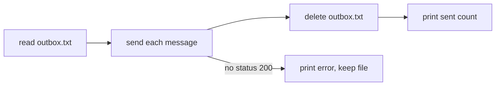

# Increment 01: push

## Goal

- The command `outbox push` sends each queued message to a server, then empties the queue.

## Out of scope

- receiving messages

## Existing tools

| Part | Checked | Decision | Reason |
|---|---|---|---|
| Sending | Go `net/http` | used | The standard library is enough for one POST per message. |

## Interface

`outbox push <url>` reads `outbox.txt`, one message per line, sends each message as the body of a `POST` to `<url>`, then deletes `outbox.txt`, prints `outbox: sent <n>` and exits with 0. When a send gets no status 200, it prints `outbox: error send: <status>`, keeps `outbox.txt` and exits with 1. Without `outbox.txt`, it prints `outbox: sent 0`.

The push flow:

## Scenarios

- **scenario 01.1** (automated) **An empty queue sends nothing.** Without `outbox.txt`, `outbox push` reports that it sent no message.
- **scenario 01.2** (manual) **Messages reach the server.** The owner queues two messages, runs `outbox push` against a test server, and sees both arrive and the queue empty.

## Evidence

- **Approved scenarios:** 01.1.
- **Manual:** 01.2.

## Rollout

- **Off switch:** none; the command has no users yet.
- **Failure signal:** a message is missing on the server, or the queue is not empty after a push.
