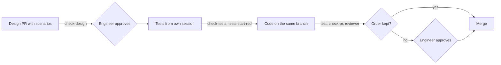

# Increment 02: trust core

## Goal

- A Go CLI `factory` checks skills, design notes, decision records, acceptance tests and the paths that a pull request changes.
- **An agent cannot approve.** Each increment has two pull requests: the design note, and the tests with their code. The engineer approves the design note with its scenarios on a protected GitHub environment; the agent token cannot give that approval. The engineer does not approve test files. The pull request with tests and code merges without the engineer when its commits keep their order (first only new test files, then only approval-free paths), the new tests failed at the end of the test phase, and all required checks pass. A commit that changes tests after that makes the pull request wait for the engineer.
- A pull request that changes design notes or the domain model, or CI or factory config, changes nothing else. A pull request with tests and code changes first only the tests group, then only approval-free paths.
- Five skills carry the workflow: `designing-increments`, `writing-acceptance-tests`, `reviewing-increments`, `writing-pull-requests` and `writing-commit-messages`. `writing-acceptance-tests` runs in its own session with a fixed prompt. `reviewing-increments` runs in the reviewer, a fresh context with a fixed prompt. `writing-pull-requests` and `writing-commit-messages` follow rule 37 and the section "Pull requests" in `AGENTS.md`.
- `designing-increments` carries the formats of the design note and the domain model as templates. It writes the scenarios for the engineer. Before the design pull request, a fresh context reads only the scenarios and says in its own words what each one means; a scenario that it cannot explain without the rest of the note is rewritten. Before it designs a part, it searches for existing tools. It asks the engineer about terms, context boundaries and dependencies between contexts in rounds of numbered questions. Each question says what it is about and the consequences of each option. It finds facts itself and gives no recommended answers.
- **The implementing session cannot end without a review.** A mandatory hook starts the reviewer. The reviewer checks the diff against the design note, checks that each test does what its scenario says, runs the demonstrated scenarios, and asks 2 or 3 comprehension questions. It publishes its result for the engineer as a Claude artifact and links it in the pull request. It turns on auto-merge only when it found nothing; otherwise the pull request waits for the engineer.
- The core of the factory imports no adapter (ADR 0001).
- Two new rules in `docs/principles.md`: a design names the existing tools it checked for each part, and building a part needs a reason; the engineer owns the terms, the context boundaries and the dependencies between contexts, and an agent stops and asks when an architecture check fails.
- The factory repo uses all of this from increment 03 on.

## Out of scope

- `factory install`, releases, the install step for cloud sessions and CI: increment 03
- an architecture check for a project's own language: increment 03
- acceptance tests in a project's own format; here, `testscript` tests the factory's own CLI, and `writing-acceptance-tests` and `check-tests` know only that format: increment 03
- receipts, the provenance log, holdout scenarios, checks for terms, one glossary per bounded context: later, see [backlog](../../backlog.md)
- adapters other than Claude Code

## Sketch

Where does the work stop for the engineer, and what is checked instead?



`check-pr` runs on every pull request. A design note always reaches "Engineer approves", because its path is in a group.

## Format

This section is the spec for the templates in the skills: `designing-increments` carries the design note and the domain model, `writing-acceptance-tests` carries the acceptance test and the runner.

**Design note**, `docs/increments/<nn>-<slug>/design.md`:

- Line 1 is `# Increment <nn>: <title>`. `<nn>` equals the folder's number.
- Required headings, exact text, any order: `## Goal`, `## Out of scope`, `## Existing tools`, `## Interface`, `## Scenarios`, `## Evidence`. Other headings are allowed.
- `## Existing tools` names, for each part that the increment builds, the tools that were checked, the decision (used, not used, later) and the reason. A part with no tool found names what was searched.
- The optional heading `## Domain` lists new or changed terms, the bounded contexts that the increment touches, and new dependencies between contexts. A new context or a new dependency between contexts also gets an architecture decision record.
- Each scenario is written for the engineer. It states behaviour in plain sentences, with a concrete example where it helps. It does not point to other sections of the note and names no exit codes or error codes; the test writer takes those from the Interface.
- A scenario line matches `^- \*\*scenario (\d{2})\.([1-9]\d*)\*\* \((automated|demonstrated|manual)\) \*\*(.+?)[.?]\*\*`. `<nn>` equals the folder's number. The title is the fourth group. Any other line that starts with `- **scenario` is an error. Lines in fenced code blocks are ignored.

**Acceptance test**, `test/acceptance/<nn>-<slug>/scenario-<nn>.<n>.txtar`: a `testscript` file, one per automated scenario. Line 1 is `# scenario <nn>.<n>: <title>`, with the title exactly as in the note: same case, without the final period or question mark. Not allowed: `skip`, `stop`, and any condition in square brackets, such as `[net]` or `[darwin]`. Example:

```
# scenario 02.1: A correct skill is accepted
exec factory validate-skills skills
stdout '^validate-skills: ok 1 checked$'

-- skills/good-skill/SKILL.md --
---
name: good-skill
description: Does one thing. Use when testing.
---
```

How to read one: `exec` runs a command that must succeed. `! exec` runs one that must fail. `exitcode N factory …` runs `factory` and checks the exact exit code. `stdout '…'` and `stderr '…'` check for a line that matches the pattern. `exists path` checks that a file exists. Each `-- path --` starts a given file.

**Runner**, `test/acceptance/acceptance_test.go`: one file runs all test files. The test writer writes it with the tests of this increment. It registers `factory` as a command, adds the command `exitcode` (because `testscript` checks only success or failure, not the exit code), sets `REPO` to the repo root (because each file runs in its own empty folder), and sets `HOME`, `GIT_CONFIG_NOSYSTEM=1` and a fresh temporary folder per file.

**Path groups.** A pull request that changes a path in a group changes no path outside that group. One exception: a pull request may first add test files and change `go.mod` and `go.sum`, and then, in later commits, change only approval-free paths.

| Group | Paths |
|---|---|
| tests | `test/acceptance/**`, `go.mod`, `go.sum` |
| design notes | `docs/increments/*/design.md`, `docs/domain/**` |
| CI and config | `.github/**`, `.factory/**` |

**Approval-free paths**, `.factory/approval-free-paths`: one path pattern per line, with `*` and `**` as in the path groups. A pull request needs no approval when every path it changes matches a line and none is in a group. A pull request with tests needs none when its commits keep this order: first commits that only add test files or change `go.mod` and `go.sum`, then commits that only change paths that match a line. A change to a test file after that, a change to a test file that already exists on the base, or a path in another group needs the engineer's approval. Without the file, every pull request needs approval.

**Domain model**, in the design-notes group. A project without bounded contexts yet has no domain model.

- `docs/domain/glossary.md`: line 1 is `# Glossary`. One line per term: `- **<Term>**: <definition>.`, optionally followed by `_Avoid_: <word> (<reason>), <word> (<reason>).`
- `docs/domain/context-map.md`: line 1 is `# Context map`. One `##` heading per bounded context, with the lines `- Folder: <path>`, `- Responsible for: <text>`, `- Not responsible for: <text>`, and one line `- Depends on: <context> (<pattern>)` per dependency. The patterns are those of DDD context mapping, for example open host service, anticorruption layer or conformist.

**Decision record**, `docs/decisions/<category>/<nnnn>-<slug>.md`, in the MADR format. The categories are `architecture` and `process`:

- Frontmatter is optional. Allowed fields: `date` (`YYYY-MM-DD`) and `status`. `status` is either `superseded by ADR-<nnnn>`, where record `<nnnn>` exists in the same category, or `deprecated`.
- The first heading is `# <title>`.
- Required `##` headings: `Context and Problem Statement`, `Considered Options`, `Decision Outcome`. Also allowed: `Decision Drivers`, `Pros and Cons of the Options`, `More Information`. No other `##` heading.
- Under `Decision Outcome`, the only `###` headings are `Consequences` and `Confirmation`. Under `Pros and Cons of the Options`, each `###` heading names an option.
- Lines in fenced code blocks are ignored.

**Skill fields**, from the Agent Skills specification:

- `name`: 1 to 64 characters; lowercase letters, digits and single hyphens; no hyphen at the start or end; equal to the folder name.
- `description`: 1 to 1024 characters.
- `compatibility`: at most 500 characters.
- `metadata`: a map of strings.
- Other allowed fields: `license`, `allowed-tools`.
- The fields `name` and `description` and the skill body must not name a specific agent tool: `claude`, `cursor`, `codex`, `copilot` or `gemini`, in any case. The field `compatibility` may name one, as the specification's own example does.

**Frontmatter subset** that `validate-skills` reads: `key: value`, quoted values, `|` and `>` blocks, and one nested map for `metadata`. Anything else is `unsupported-yaml`.

## Existing tools

| Part | Tools checked | Decision | Reason |
|---|---|---|---|
| Design-note format, `check-design`, `designing-increments` | GitHub Spec Kit and OpenSpec (both MIT); Kiro | not used | Spec Kit and OpenSpec would replace only `check-design` and part of one skill. Neither has a merge gate, tests from a separate session, or protected tests. Kiro is its own editor and CLI with its own credits and works with no other agent. |
| Approval flow | Swamp, extension `@swamp/software-factory` | not used | Every Swamp command except a few, such as `help` and `auth`, needs a swamp-club.com account; CI needs a token from that service. A `human-approval` decision is a record that any process with the CLI can write, so it does not stop an agent. |
| `validate-skills` | `skills-ref` from agentskills.io | not used | Its README: "This library is intended for demonstration purposes only. It is not meant to be used in production." |
| `check-adr` | adr-guard (.NET, MIT), adrscope (Rust, MIT) | not used | Each needs another runtime in the CI of every project; `check-adr` ships in the one `factory` binary (ADR 0001). adrscope expects structured MADR with its own frontmatter fields. |
| `check-pr` path groups | GitHub push rulesets, rule "Restrict file paths" | not used | GitHub offers push rulesets only for private and internal repositories. The factory repo is public. |
| Review result for the engineer | Claude artifacts | used, in the Claude Code adapter | The engineer's choice. The skill writes a tool-neutral report; the adapter publishes it. |
| Starting the reviewer | Claude Code hooks of type `agent` | not used | They are experimental, can use only tools like Read, Grep and Glob, and time out after 60 seconds by default, so they cannot run scenarios. |
| Review in CI | Copilot code review; Opper; GitHub Models | not used | Copilot reviews cost AI credits and are comments only, so they cannot block a merge. GitHub Models was retired on 2026-07-30. A single model call in CI adds little to the acceptance tests. |
| Tests and code together on `main` | GitHub stacked pull requests | not used | GitHub has no auto-merge for stacks, and the tests pull request of a stack can merge alone and turn `main` red. Public preview since 2026-07-30. |
| `hook pre-tool-use` | Claude Code `permissions.deny` | not used | "An allow rule can't carve an exception out of a deny rule", so a project deny rule on the tests group would also block the test-writer session. |
| Acceptance tests | `testscript` from `github.com/rogpeppe/go-internal` (BSD-3-Clause) | used | The Go team's own script engine for testing the `go` command, factored out into a separate module. One readable file per scenario. A test-only dependency, which `AGENTS.md` allows. |
| Mutation score | Gremlins, go-mutesting | Gremlins used | Made for small Go modules like this one. It is before version 1.0; the score does not block a merge, so a fault in the tool blocks nothing. |
| Check that the core imports no adapter | go-arch-lint (MIT) | not used | One rule needs only `go list`. go-arch-lint fits a project with several rules. |
| Interview in `designing-increments` | skills `grilling` and `domain-modeling` by Matt Pocock (MIT) | idea used, files not used | Their frontmatter has fields outside the allowed skill fields. They give a recommended answer to each question, which the factory leaves out, so that the engineer decides instead of agreeing. |
| Domain model | Context Mapper (CML, Apache-2.0); ddd-crew Bounded Context Canvas (CC BY-SA 4.0) | later | Context Mapper needs a JDK and checks no TypeScript or Go code. The canvas pays off from the second bounded context. |

## Interface

Every output line starts with the command name and a colon, for example `check-pr:`. An error line is `<command>: error <where>: <code> <detail>`. `<where>` is a path, or `path:line` when the line is known. The last line is `<command>: ok <n> checked` or `<command>: <n> errors`. Exit codes: 0 ok, 1 errors, 2 usage or environment.

| Command | Codes |
|---|---|
| `factory validate-skills [dir ...]` | `name-mismatch`, `name-format`, `name-too-long`, `description-missing`, `description-too-long`, `compatibility-too-long`, `metadata-not-map`, `unknown-field`, `no-frontmatter`, `unsupported-yaml`, `tool-name` |
| `factory check-design <increment-dir>` | `bad-title`, `missing-section`, `bad-scenario-line`, `wrong-increment`, `duplicate-id` |
| `factory check-adr [dir]` | `unknown-category`, `unknown-field`, `bad-date`, `bad-status`, `unknown-adr`, `missing-title`, `missing-section`, `unknown-section`. Checks every `.md` file under `dir`, by default `docs/decisions`. A file outside the folders `architecture` and `process` is `unknown-category`. |
| `factory check-tests [--base <ref>]` | `missing-test`, `unknown-id`, `title-mismatch`, `forbidden-command`. Reads the design notes from `<ref>`, or from the working tree without `--base`. Reads the test files from the working tree. |
| `factory check-pr --base <ref>` | `mixed-pr`, with the paths of each group. Reads the commits between the merge base with `<ref>` and `HEAD`. Tests first and approval-free paths after them are not `mixed-pr`. Exit 2 with `shallow-clone`. Before the last line, prints `check-pr: approval required` or `check-pr: approval not required`, and, when the pull request has tests, `check-pr: tests end at <commit>` with the last commit of the test phase. Reads `.factory/approval-free-paths` from `<ref>`. |
| `factory hook stop` | Reads Claude Code hook input for `Stop` on stdin: `stop_hook_active`, `cwd`. Prints a block decision while the latest commit that changes a path on the list of approval-free paths has no review result in `evidence/<nn>-<slug>/review.md` that names that commit. The reason names the step that starts the reviewer. Prints nothing when `stop_hook_active` is true. |
| `factory hook pre-tool-use` | Reads Claude Code hook input on stdin: `tool_name`, `tool_input.file_path` or `tool_input.notebook_path`, `agent_type`, `agent_id`, `cwd`. Prints a deny decision as JSON for `Write`, `Edit`, `MultiEdit` and `NotebookEdit` on a path in the tests group or the CI-and-config group, and nothing otherwise. Exception: a write under `test/acceptance/` when `agent_type` is `acceptance-test-writer` and `agent_id` is absent, which marks a session started with that agent, not a subagent. |

**CI in the factory repo**, after this increment:

- Workflow `gate` on `pull_request_target`. GitHub then takes the workflow file and the checkout from `main`.
  - Job `checks` builds `factory` from `main`, fetches the pull request as data, and runs `check-pr`, `check-design` for each changed note and `check-adr`. It runs `check-tests --base main` only when the pull request changes the tests group or an approval-free path, so a design note without tests blocks code, not docs. When `check-pr` names the last commit with tests, the job reads that commit's check results through the REST API and requires that `tests-start-red` passed there. It runs no code from the pull request and has only read permission for checks. Its output `approval` is `not-required` only when all checks pass, `check-pr` prints `approval not required`, `tests-start-red` passed where required, and the head branch is in the repo itself, not in a fork. Otherwise it is `required`.
  - Job `approval` runs after `checks` with `if: always()`, so it is never skipped; GitHub counts a skipped job as a passed required check. It uses the environment `no-approval`, which has no reviewers, only when the output of `checks` is `not-required`. In every other case, also when `checks` fails or sets no output, it uses the environment `approval`.
- Workflow `test` on `pull_request` has two jobs:
  - Job `test` runs `go test ./...`, which includes the acceptance tests. All tests must pass. While a pull request has new test files but not their code, `test` fails, so the pull request cannot merge yet. On a pull request that changes code, the job also mutates the code of `factory` with Gremlins, runs the acceptance tests against each mutant, and reports the mutation score in its summary. The score does not block a merge.
  - Job `tests-start-red`, not required: on a commit whose changes since the base are only in the tests group, each added test file must fail and every other test must pass.
- The ruleset on `main` requires `checks`, `approval` and `test`.

## Scenarios

### Skill check

- **scenario 02.1** (automated) **A correct skill is accepted.** `factory validate-skills` accepts a skill whose fields all follow the Agent Skills rules.
- **scenario 02.2** (automated) **Each mistake in a skill is reported.** For every mistake that the skill check knows, such as a name that differs from the folder name or a missing description, a skill with exactly that mistake is rejected. The output names the file and the mistake.

### Design note check

- **scenario 02.3** (automated) **A complete design note is accepted.** `factory check-design` accepts a design note that has all required sections and correctly written scenario lines.
- **scenario 02.4** (automated) **Each mistake in a design note is reported.** For every mistake that the design check knows, such as a missing section or a scenario with the wrong increment number, a note with exactly that mistake is rejected. The output names the line and the mistake.

### Test check

- **scenario 02.5** (automated) **Matching tests are accepted.** `factory check-tests` accepts a design note together with exactly one test file for each of its automated scenarios.
- **scenario 02.6** (automated) **Each mistake in the tests is reported.** For every mistake that the test check knows, such as a missing test file, a test for a scenario that does not exist, a title that differs from its scenario, or a forbidden command such as `skip`, the tests are rejected. The output names the scenario or the file and the mistake.
- **scenario 02.7** (automated) **Code waits for its tests.** When a design note on `main` has automated scenarios without test files, `factory check-tests --base main` rejects the pull request. A design note that exists only in the pull request itself does not count yet.

### Pull request paths

- **scenario 02.8** (automated) **A pull request with one kind of change is accepted.** `factory check-pr` accepts a pull request that changes only a design note, or only test files and `go.mod`, or only paths outside all groups.
- **scenario 02.9** (automated) **A pull request that mixes kinds of change is rejected.** `factory check-pr` rejects a pull request that changes a test file and a design note, or code and a file under `.github/`. The output names the paths. A clone without its full history is reported as a problem of the environment, not of the pull request.
- **scenario 02.22** (automated) **Code-only pull requests need no approval.** With `internal/**` on the list of approval-free paths on `main`, `factory check-pr` reports that a pull request that changes only `internal/x.go` needs no approval. It reports that approval is needed for a pull request that also changes `README.md`, when `main` has no such list, and for a list with `**` when the pull request changes a design note.
- **scenario 02.25** (automated) **Tests first, then code, needs no approval.** With `internal/**` on the list of approval-free paths, a pull request whose first commits only add test files and whose later commits only change `internal/x.go` needs no approval, and `factory check-pr` names the last commit with tests. Approval is needed when a later commit changes a test file again, or when a commit with tests changes a test file that already exists on `main`.

### Approval and credentials (manual, in the factory repo)

- **scenario 02.10** (manual) **Only a person approves.** A design note cannot be merged before a required reviewer approves the `approval` job, and each new push needs a new approval. The agent token cannot give that approval. A pull request that brings its own workflow with a fake job named `approval` still cannot be merged, also when its target branch changes to `main` later. A pull request from a fork always waits for a reviewer. A pull request with tests first and then code merges without a reviewer once all checks pass; when a later commit changes a test again, it waits for a reviewer.
- **scenario 02.11** (manual) **The gate always comes from main.** A pull request that changes the `gate` workflow still runs the version from `main`, and the result shows on the pull request.
- **scenario 02.12** (manual) **Agent sessions cannot get around the gate.** A local agent session cannot push a change under `.github/workflows/`, cannot read the repo's rulesets, cannot get a GitHub token through `gh auth token` or `git credential fill`, and cannot read `~/.ssh`. A cloud session cannot approve the `approval` job and cannot change the ruleset through the API.
- **scenario 02.20** (manual) **New tests start red.** On a pull request with new test files and no code yet, `tests-start-red` passes only when each new test fails and every other test passes. Until the code exists, `test` fails, so the pull request cannot merge. When `tests-start-red` failed on the last commit with tests, the pull request waits for a reviewer.
- **scenario 02.21** (manual) **The strength of the tests is measured.** A pull request with code shows, in the summary of the job `test`, the share of deliberately broken versions of the code (mutants) that the acceptance tests catch. A low share does not block the merge.

### Hooks (Claude Code adapter)

- **scenario 02.13** (automated) **Only the test writer may write tests.** The guard hook refuses edits to test files and to files under `.github/` and `.factory/`. Only a session started as `acceptance-test-writer` may write test files.
- **scenario 02.24** (automated) **An implementing session cannot end without a review.** When the latest code commit has no review result yet, the stop hook keeps the session from ending and names the step that starts the reviewer. With a review result for that commit, it lets the session end. It never blocks twice in a row, so a session cannot loop forever.

### Skills

- **scenario 02.14** (automated) **The factory's skills are valid and name no agent tool.** `factory validate-skills` accepts all skills under `core/skills` in the repo (ADR 0001 confirmation).
- **scenario 02.15** (demonstrated) **Each skill works in a fresh repo.** For each skill, one task runs once without and once with the skill, each in a fresh temporary repo without `AGENTS.md`, design notes or git history. The check command runs only afterwards. The recordings go to `evidence/`. This shows that the skill works, not how much it helps.
- **scenario 02.16** (manual) **The skills help in real use.** Over increment 03 and the first two increments of a project that uses the factory, `retro.md` counts the test writer's questions, tests changed after review, review findings, and the engineer's interventions. For each design note, the engineer records yes or no, with a reason: was the note clear enough for the test writer?
- **scenario 02.17** (manual) **The review is readable.** For increment 02 itself, the reviewer's result lists its findings on special cases, code that detects a test run, work outside the scenarios, tests that do not do what their scenario says, and docs with their own history or with elements outside their format. It ends with 2 or 3 comprehension questions and the engineer's answers. The engineer opens it as a Claude artifact from the link in the pull request.

### Architecture of the factory

- **scenario 02.23** (automated) **The core uses no adapter.** No Go package outside `adapters/` and `cmd/` depends on a package under `adapters/` (ADR 0001 confirmation).

### Decision record check

- **scenario 02.18** (automated) **A correct decision record is accepted.** `factory check-adr` accepts a record in each category that uses only the allowed fields and headings.
- **scenario 02.19** (automated) **Each mistake in a decision record is reported.** For every mistake that the record check knows, such as an unknown category, an unknown heading or a status that points to a missing record, a record with exactly that mistake is rejected. The output names the line and the mistake.

## Evidence

- **Approved scenarios:** 02.1 to 02.9, 02.13, 02.14, 02.18, 02.19, 02.22 to 02.25. The engineer approves them in this note; their `testscript` files come from the test-writer session.
- **Demonstrated:** 02.15.
- **Manual:** 02.10, 02.11, 02.12, 02.16, 02.17, 02.20 and 02.21.
- **Measurement, not evidence:** the mutation score from 02.21, recorded in `retro.md`.
- **ADR confirmation:** 02.14 and 02.23.
- **Not evidence:** unit tests from the implementing agent.

## Setup before the first pull request

These steps need a person with admin rights on the repo. [docs/setup/README.md](../../setup/README.md) lists them: repo settings, agent token, environment `approval`, approval workflow, ruleset, and the settings for local agent sessions.

After this increment, a CI pull request adds the jobs `checks`, `test` and `tests-start-red`, and makes `checks` and `test` required. It also adds `.factory/approval-free-paths` with the paths of the Go code and `evidence/**`. Skills, docs and adapter settings are not on the list, because they steer the agents.

## Limits

- **Bootstrap:** this increment's pull requests run before `factory` exists on `main`. Until the CI pull request, only `approval` is required, and the engineer checks the paths with `git diff --stat`. The engineer reads `check-pr`, `check-tests` and the part of `gate` that reads `tests-start-red` line by line in the review, because they guard all later pull requests.
- **One account:** agents act under the engineer's GitHub account, and GitHub cannot tell them apart. In local sessions, the guards are the missing token rights (Deployments, Workflows, Administration) and the sandbox. Cloud sessions use the engineer's own credentials through the GitHub proxy and can push workflow files. There the guards are the ruleset, which binds every account, and the approval, which needs a person. Scenario 02.12 checks both.
- **Guard hook:** it works only in Claude Code, and Bash can get around it. It gives early feedback only.
- **Merge without approval:** before such a merge, the acceptance tests pass in CI, the order of commits holds, and the reviewer found nothing, also that each test does what its scenario says. The engineer approves the scenarios, not the test files. All sessions act under one account, so nothing hard stops an agent from writing a weak test in the test phase; the reviewer, the mutation score and `tests-start-red` are the guards. The reviewer runs in the implementing session's environment, so its "nothing found" is a strong signal, not proof. The manual scenarios run after the merge; a finding becomes a fix in a new pull request.
- **Break glass:** the engineer can switch off the ruleset in the settings, for example for an urgent fix while a design note on `main` has no tests yet. The next retro records each use.
