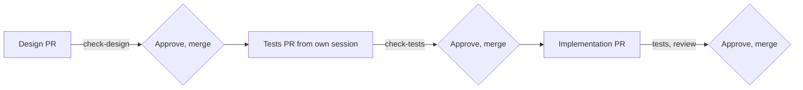

# Increment 02: trust core

## Goal

- A Go CLI `factory` checks skills, design notes, acceptance tests and the paths that a pull request changes.
- **An agent cannot approve.** Each increment has three pull requests: design note, tests, implementation. Each one waits for the engineer's approval on a protected GitHub environment. The agent token cannot give that approval. "Approved" means "merged on `main`".
- A pull request that changes tests, design notes, CI or factory config changes nothing else. So the engineer sees each such change as its own pull request.
- Three skills carry the workflow: `designing-increments`, `writing-acceptance-tests` and `reviewing-increments`. The second and third run in their own sessions with fixed prompts.
- The factory repo uses all of this from increment 03 on.

## Out of scope

- `factory install`, releases, the install step for cloud sessions and CI: increment 03
- receipts, the provenance log, holdout scenarios: later, see [backlog](../../backlog.md)
- adapters other than Claude Code

## Sketch

Where does the work stop until the engineer approves, and what is checked before each stop?



`check-pr` runs on every pull request.

## Format

**Design note**, `docs/increments/<nn>-<slug>/design.md`:

- Line 1 is `# Increment <nn>: <title>`. `<nn>` equals the folder's number.
- Required headings, exact text, any order: `## Goal`, `## Out of scope`, `## Interface`, `## Scenarios`, `## Evidence`, `## Open questions`. Other headings are allowed.
- A scenario line matches `^- \*\*scenario (\d{2})\.([1-9]\d*)\*\* \((automated|demonstrated|manual)\) \*\*(.+?)[.?]\*\*`. `<nn>` equals the folder's number. The title is the third group. Any other line that starts with `- **scenario` is an error. Lines in fenced code blocks are ignored.
- A note that is not ready for its pull request is named `draft.md`. The checks ignore drafts.

**Acceptance test**, `test/acceptance/<nn>-<slug>/scenario-<nn>.<n>.txtar`: a `testscript` file, one per automated scenario. Line 1 is `# scenario <nn>.<n>: <title>`, with the title exactly as in the note: same case, without the final period or question mark. Not allowed: `skip`, `stop`, and any condition in square brackets, such as `[net]` or `[darwin]`. Example:

```
# scenario 02.1: A valid skill passes
exec factory validate-skills skills
stdout '^validate-skills: ok 1 checked$'

-- skills/good-skill/SKILL.md --
---
name: good-skill
description: Does one thing. Use when testing.
---
```

How to read one: `exec` runs a command that must succeed. `! exec` runs one that must fail. `exitcode N factory …` runs `factory` and checks the exact exit code. `stdout '…'` and `stderr '…'` check for a line that matches the pattern. `exists path` checks that a file exists. Each `-- path --` starts a given file.

**Runner**, `test/acceptance/acceptance_test.go`: one file runs all test files. The test writer writes it in the tests pull request of this increment. It registers `factory` as a command, adds the command `exitcode`, sets `REPO` to the repo root, and sets `HOME`, `GIT_CONFIG_NOSYSTEM=1` and a fresh temporary folder per file.

**Path groups.** A pull request that changes a path in a group changes no path outside that group:

| Group | Paths |
|---|---|
| tests | `test/acceptance/**`, `go.mod`, `go.sum` |
| design notes | `docs/increments/*/design.md`, `docs/increments/*/draft.md` |
| CI and config | `.github/**`, `.factory/**` |

**Skill fields**, from the Agent Skills specification:

- `name`: 1 to 64 characters; lowercase letters, digits and single hyphens; no hyphen at the start or end; equal to the folder name.
- `description`: 1 to 1024 characters.
- `compatibility`: at most 500 characters.
- `metadata`: a map of strings.
- Other allowed fields: `license`, `allowed-tools`.
- A skill must not name a specific agent tool: `claude`, `cursor`, `codex`, `copilot` or `gemini`, in any case.

**Frontmatter subset** that `validate-skills` reads: `key: value`, quoted values, `|` and `>` blocks, and one nested map for `metadata`. Anything else is `unsupported-yaml`.

## Interface

Every output line starts with the command name and a colon, for example `check-pr:`. An error line is `<command>: error <where>: <code> <detail>`. `<where>` is a path, or `path:line` when the line is known. The last line is `<command>: ok <n> checked` or `<command>: <n> errors`. Exit codes: 0 ok, 1 errors, 2 usage or environment.

| Command | Codes |
|---|---|
| `factory validate-skills [dir ...]` | `name-mismatch`, `name-format`, `name-too-long`, `description-missing`, `description-too-long`, `compatibility-too-long`, `metadata-not-map`, `unknown-field`, `no-frontmatter`, `unsupported-yaml`, `tool-name` |
| `factory check-design <increment-dir>` | `bad-title`, `missing-section`, `bad-scenario-line`, `wrong-increment`, `duplicate-id` |
| `factory check-tests [--base <ref>]` | `missing-test`, `unknown-id`, `title-mismatch`, `forbidden-command`. Reads the design notes from `<ref>`, or from the working tree without `--base`. Reads the test files from the working tree. |
| `factory check-pr --base <ref>` | `mixed-pr`, with the paths of each group. Compares `HEAD` with its merge base with `<ref>`. Exit 2 with `shallow-clone`. |
| `factory hook pre-tool-use` | Reads Claude Code hook input on stdin: `tool_name`, `tool_input.file_path` or `tool_input.notebook_path`, `agent_type`, `agent_id`, `cwd`. Prints a deny decision as JSON, or nothing. |

**CI in the factory repo**, after this increment:

- Workflow `gate` on `pull_request_target`. GitHub then takes the workflow file and the checkout from `main`.
  - Job `checks` builds `factory` from `main`, fetches the pull request as data, and runs `check-pr`, `check-design` for each changed note, and `check-tests --base main`. It runs no code from the pull request and has no permissions.
  - Job `approval` needs `checks` and uses the environment `approval`.
- Workflow `test` on `pull_request` runs `go test ./...`, which includes the acceptance tests.
- The ruleset on `main` requires `checks`, `approval` and `test`.

## Scenarios

### Skill check

- **scenario 02.1** (automated) **A valid skill passes.** Given a skill with only allowed fields, `factory validate-skills` exits with 0.
- **scenario 02.2** (automated) **Invalid skills fail with a code.** Given one skill per skill-check code from the Interface, it exits with 1 and prints that code for that file.

### Design note check

- **scenario 02.3** (automated) **A note in the format passes.** Given a note that follows the Format, `factory check-design` exits with 0.
- **scenario 02.4** (automated) **A faulty note fails with a code.** Given one note per design-check code, it exits with 1 and prints the code with the line number.

### Test check

- **scenario 02.5** (automated) **One file per automated scenario passes.** Given a note and one test file per automated scenario, `factory check-tests` exits with 0.
- **scenario 02.6** (automated) **Wrong test files fail with a code.** Given one case per test-check code, it exits with 1 and prints the code and the id or file.
- **scenario 02.7** (automated) **Tests come before the implementation.** Given a note on the base branch whose test files are missing or deleted, `factory check-tests --base` exits with 1 with `missing-test`. Given a note that exists only in the working tree, it exits with 0.

### Pull request paths

- **scenario 02.8** (automated) **A pull request within one group passes.** Given a pull request that changes only a design note, or only test files and `go.mod`, or only paths outside all groups, `factory check-pr` exits with 0.
- **scenario 02.9** (automated) **A mixed pull request fails.** Given a pull request that changes code and a test file, or a test file and a design note, or code and a file under `.github/`, `factory check-pr` exits with 1 with `mixed-pr` and names the paths. Given a shallow clone, it exits with 2 with `shallow-clone`.

### Approval and credentials (manual, in the factory repo)

- **scenario 02.10** (manual) **Only the engineer approves.** A pull request cannot be merged before the engineer approves the `approval` job. After a new push, it needs a new approval. An attempt with the agent token to approve the job fails.
- **scenario 02.11** (manual) **The gate comes from main.** A pull request that changes the `gate` workflow still runs the version from `main`, and its `checks` result shows on the pull request.
- **scenario 02.12** (manual) **Agents cannot use the engineer's credentials.** From a local agent session, a push of a change under `.github/workflows/` fails, and reading the repo's rulesets through the API fails. From a cloud session, the push fails too.

### Guard hook (early feedback, Claude Code adapter)

- **scenario 02.13** (automated) **Protected files.** Given hook input for `Write`, `Edit`, `MultiEdit` or `NotebookEdit` on a path in the tests group or the CI-and-config group, the hook prints a deny decision. The only exception: a write to `test/acceptance/` by a session started as `acceptance-test-writer`, with `agent_type` set and no `agent_id`.

### Skills

- **scenario 02.14** (automated) **The factory's skills are valid and tool-neutral.** `factory validate-skills "$REPO/core/skills"` exits with 0 (ADR 0001 confirmation).
- **scenario 02.15** (demonstrated) **Smoke run.** For each skill, one task runs once without and once with the skill, each in a fresh temporary repo without `AGENTS.md`, design notes or git history. The check command runs only afterwards. The recordings go to `evidence/`. This shows that the skill works, not how much it helps.
- **scenario 02.16** (manual) **Value in real use.** Over increment 03 and the first two `health` increments, `retro.md` counts the test writer's clarifying questions, tests changed after review, review findings, and the engineer's interventions. For each note, the engineer records yes or no, with a reason: was the note clear enough for the test writer?
- **scenario 02.17** (manual) **Review is recorded.** For increment 02 itself, `review.md` has the reviewer's findings on special cases, test detection and work outside the scenarios, plus 2 or 3 comprehension questions with the engineer's answers.

## Evidence

- **Approved scenarios:** 02.1 to 02.9, 02.13 and 02.14, as `testscript` files from the test-writer session, merged with the tests pull request.
- **Demonstrated:** 02.15.
- **Manual:** 02.10, 02.11, 02.12, 02.16 and 02.17.
- **ADR confirmation:** 02.14.
- **Not evidence:** unit tests from the implementing agent.

## Setup before the first pull request

The engineer does these steps. The files are in [docs/setup/](../../setup/).

1. **Agent token:** fine-grained, for the factory repo and `health`. Contents and Pull requests write, nothing else.
2. **Environment `approval`** in the factory repo: the engineer as required reviewer. "Prevent self-review" stays off, because agents act under the engineer's account. "Allow administrators to bypass" is off.
3. **Approval workflow:** the engineer commits `docs/setup/approval.yml` as `.github/workflows/approval.yml` and merges it.
4. **Ruleset:** the engineer imports `docs/setup/ruleset.json`: pull requests only, squash merges only, required check `approval`, no force push, no deletion, empty bypass list.
5. **Before the first local agent session:** Claude Code user settings deny reading `~/.ssh`, `~/.config/gh` and the SSH agent socket, set `allowUnsandboxedCommands: false`, and give git the agent token.

After this increment, a CI pull request adds the jobs `checks` and `test` and makes them required.

## Limits

- **Bootstrap:** this increment's pull requests run before `factory` exists on `main`. Until the CI pull request, only `approval` is required, and the engineer checks the paths with `git diff --stat`. The engineer reads `check-pr` and `check-tests` line by line in the review, because they guard all later pull requests.
- **One account:** agents act under the engineer's GitHub account, and GitHub cannot tell them apart. The guards are the missing token rights (Deployments, Workflows, Administration) and the sandbox. An agent that gets the engineer's own token can approve. Scenario 02.12 checks this.
- **Not verified:** whether the checks from `pull_request_target` count as required checks on the pull request. Scenarios 02.10 and 02.11 show it. If not, `gate` runs on `pull_request`, and the missing Workflows right is the only guard for the workflow files.
- **Guard hook:** it works only in Claude Code, and Bash can get around it. It gives early feedback only.
- **Break glass:** the engineer can switch off the ruleset in the settings. The next retro records each use.

## Open questions

1. **Test dependency:** `testscript` (`github.com/rogpeppe/go-internal`) as a test-only dependency. Is that right?
2. **Runner:** the runner adds the command `exitcode` and the variable `REPO`, because `testscript` has neither. Is that right?
