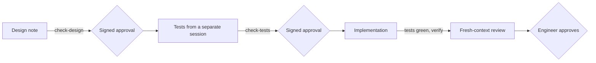

# Increment 02: trust core

Status: proposed

## Goal

- A Go CLI `factory` checks skills, design notes and acceptance tests.
- **Approvals cannot come from an agent.** The engineer approves a design note or a set of tests with a commit signed by a key that needs Touch ID. CI verifies the signature and the approved content.
- Two skills carry the workflow: `designing-increments` and `writing-acceptance-tests`. A separate session with a fixed prompt uses the second one.
- The factory repo works with all of this from increment 03 on, and its own CI runs the checks.

## Out of scope

- `factory install`, releases, the cloud and CI install step, the ruleset: increment 03
- the provenance log and the workflow gate: increment 04
- adapters other than Claude Code
- Gherkin. Scenarios are Markdown, and their grammar is fixed below.

## Sketch

Where does the work stop until the engineer approves, and what is checked before each stop?



## Format

**Design note.** The file is `docs/increments/<nn>-<slug>/design.md`.

- The first line is `# Increment <nn>: <title>`.
- A line `Status: proposed` follows. The status line never says `approved`: an approval exists only as a signed approval commit.
- These sections are required, as `## Goal`, `## Out of scope`, `## Interface`, `## Scenarios`, `## Evidence` and `## Open questions`. Other sections are allowed.
- **Scenario line**, matching `^- \*\*scenario (\d{2})\.(\d+)\*\* \((automated|demonstrated|manual)\) \*\*(.+?)\.\*\*`. The number in the id must match `<nn>` of the folder.

**Acceptance test.** One `testscript` file per automated scenario: `test/acceptance/<nn>-<slug>/scenario-<nn>.<n>.txtar`. Its first line is `# scenario <nn>.<n>: <title>`. Below it come the commands and expected outputs. The given files follow as `-- path --` sections. Example:

```
# scenario 02.1: a valid skill passes
exec factory validate-skills skills
stdout 'skills: 1 checked, 0 with errors'

-- skills/good-skill/SKILL.md --
---
name: good-skill
description: Does one thing. Use when testing.
---
# Body
```

One runner, `test/acceptance/acceptance_test.go`, runs all files. The engineer reviews the runner once.

**Approval record.** The file is `docs/increments/<nn>-<slug>/approvals.json`. It holds the SHA-256 of `design.md`, and after the test approval also the SHA-256 of each test file. The commit that changes it must be signed by a key from `.factory/allowed_signers` on the base branch.

## Interface

| Command | Exit code | Output |
|---|---|---|
| `factory validate-skills [dir ...]` | 0 ok, 1 errors, 2 usage | `skills: error <file>: <reason>`, then `skills: <n> checked, <m> with errors` |
| `factory check-design <increment-dir>` | 0, 1, 2 | `design: error <file>:<line>: <problem>` |
| `factory check-tests <increment-dir>` | 0, 1, 2 | `tests: error <scenario id or file>: <problem>` |
| `factory approve <increment-dir> design\|tests` | 0, 1, 2 | writes `approvals.json` and creates a signed commit |
| `factory verify [--base <ref>]` | 0, 1, 2 | `verify: error <file>: <problem>` |
| `factory hook pre-tool-use` | 0 | a deny decision as JSON on stdout. If the action is allowed, it prints nothing. |

## Scenarios

### Skill check

- **scenario 02.1** (automated) **A valid skill passes.** Given a skill with only standard fields, when `factory validate-skills` runs, then it exits with 0.
- **scenario 02.2** (automated) **Invalid skills fail.** Given one skill per case, then it exits with 1 and prints one error line per case with the file and the reason:
  - the name differs from the folder
  - the name is not lowercase with single hyphens
  - the name is longer than 64 characters
  - no description, or a description longer than 1024 characters
  - `compatibility` is longer than 500 characters
  - `metadata` is not a map of strings
  - a field outside the standard
  - no frontmatter

### Design note check

- **scenario 02.3** (automated) **A note in the format passes.** Given a note that follows the format above, when `factory check-design` runs, then it exits with 0.
- **scenario 02.4** (automated) **A faulty note fails.** Given one note per case, then it exits with 1 and names the line:
  - a required section is missing
  - a scenario line breaks the grammar
  - an id carries another increment number
  - an id appears twice
  - the status line says `approved`

### Test check

- **scenario 02.5** (automated) **One file per automated scenario passes.** Given a note and exactly one test file per automated scenario, when `factory check-tests` runs, then it exits with 0. Demonstrated and manual scenarios need no file.
- **scenario 02.6** (automated) **Missing or extra files fail.** Given one case each, then it exits with 1 and names the id:
  - an automated scenario has no file
  - a file has an id that is not in the note
  - a file's first line does not match its name

### Signed approval

The tests use a temporary repo and a test key without Touch ID.

- **scenario 02.7** (automated) **A signed approval passes.** Given an approval commit signed by a key in `allowed_signers` on the base branch, and unchanged approved files, when `factory verify` runs, then it exits with 0.
- **scenario 02.8** (automated) **An unsigned or foreign approval fails.** Given an approval commit that is unsigned, or signed by a key that is not in `allowed_signers` on the base branch, then `factory verify` exits with 1 and names `approvals.json`.
- **scenario 02.9** (automated) **A change after the approval fails.** Given a signed approval, when an approved file changes afterwards, then `factory verify` exits with 1 and names the file.
- **scenario 02.10** (automated) **A new signer must be signed in.** Given a branch that adds a key to `allowed_signers` in a commit not signed by a key from the base branch, then `factory verify` exits with 1.
- **scenario 02.11** (manual) **Touch ID approves.** On the Mac, `factory approve` asks for Touch ID. GitHub shows the commit as verified, and `factory verify` passes in CI.

### Guard hook (early feedback, Claude Code adapter)

- **scenario 02.12** (automated) **Writes to protected files are denied.** Given hook input for a write by any agent other than `acceptance-test-writer` to `test/acceptance/`, an `approvals.json` or `.factory/allowed_signers`, then the hook prints a deny decision with a reason.
- **scenario 02.13** (automated) **The test agent writes only before the test approval.** Given hook input for a write by `acceptance-test-writer` to its increment's test folder, then the hook prints nothing while no test approval exists, and a deny decision after.

### Skills

- **scenario 02.14** (automated) **The skills are valid and tool-neutral.** Given both skills, then `factory validate-skills` exits with 0, and no file under `core/` or in the tool-neutral packages names an agent tool (ADR 0001 confirmation).
- **scenario 02.15** (demonstrated) **Clean comparison.** For each skill there is 1 task. It runs 3 times without and 3 times with the skill, each time in a fresh temporary repo without `AGENTS.md`, design notes or git history. The check command is available in both variants. The recordings and the pass counts go to `evidence/`. Expected: with the skill, 3 of 3 pass. The runs without the skill are the baseline.
- **scenario 02.16** (manual) **Rating in real use.** In increment 03, the engineer rates the design note and the tests made with the skills on 4 criteria, and the number of interventions is counted. The result goes into increment 03's evidence.
  - the scenarios are unambiguous
  - the interface is enough for the test writer
  - the result is readable for the engineer
  - nothing in scope is missing

## Evidence

- **Approved scenarios:** 02.1 to 02.10 and 02.12 to 02.14, as `testscript` files from a separate session, approved with a signature.
- **Demonstrated:** 02.15.
- **Manual:** 02.11, and 02.16 in increment 03.
- **ADR confirmation:** part of 02.14.
- **Review:** a fresh-context review of the diff, looking for special cases, test detection and anything outside the scenarios. It ends with 2 or 3 comprehension questions, at least one about debugging.
- **Not evidence:** unit tests from the implementing agent.

## Limits

- **Setup before the first approval:** the engineer creates the key in Secretive and puts its public key into `.factory/allowed_signers` on `main`, in a commit signed with that key. Until then, no approval can be verified.
- Increment 02 builds `factory approve` and `factory verify` itself. Its own approvals therefore use plain `git commit -S` with the Touch ID key, and `factory verify` checks them afterwards.
- The guard hook works only in Claude Code, and Bash can get around it. It only gives early feedback. The real check is `factory verify` in CI, and from increment 03 on the ruleset blocks the merge.
- Touch ID prompts appear for every signing. The engineer touches only when the engineer started the approval.

## Open questions

1. **Signers file:** `.factory/allowed_signers` lists only the engineer's Secure Enclave key. Is that right?
2. **Test dependency:** `testscript` (`github.com/rogpeppe/go-internal`) is allowed as a test-only dependency. Is that right?
3. **Agent commits** stay unsigned. Only approvals are signed. Is that right?
