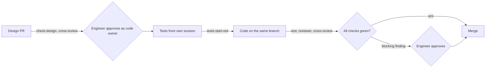

# Increment 02: trust core

## Goal

- A Go CLI `factory` checks skills, design notes, decision records, acceptance tests and the paths that a pull request changes.
- **An agent cannot approve.** Agents act as a machine account with write access and no admin rights. The engineer approves owned paths as code owner, with a personal account. A pull request that changes no owned path merges as soon as its checks pass.
- Each increment has two pull requests: the design note, and the tests with their code. Tests come first, and `tests-start-red` shows that they failed before the code came.
- Five skills carry the workflow: `designing-increments`, `writing-acceptance-tests`, `reviewing-increments`, `writing-pull-requests` and `writing-commit-messages`. They follow the Agent Skills specification and its guides, and each has evals that run with and without the skill. `designing-increments` asks the engineer in rounds, without recommended answers, and has a fresh context explain each scenario before the design pull request.
- A stop hook makes the implementing session start a reviewer in a fresh context. It checks the diff and whether each test does what its scenario says, and its result reaches the engineer as a Claude artifact. It turns on auto-merge only when it found nothing.
- A model from another vendor reviews both pull requests in the check `cross-review`.
- The core of the factory imports no adapter (ADR 0001).
- Two new rules in `docs/principles.md`: a design names the existing tools it checked; the engineer owns terms, context boundaries and dependencies between contexts.

## Out of scope

- `factory install`, releases, the install step for cloud sessions and CI: increment 03
- an architecture check and acceptance tests in a project's own language and format: increment 03
- receipts, the provenance log, holdout scenarios, checks for terms, one glossary per bounded context: later, see [backlog](../../backlog.md)
- adapters other than Claude Code

## Sketch

Where does the work stop for the engineer?

## Format

**Design note**, `docs/increments/<nn>-<slug>/design.md`:

- Line 1 is `# Increment <nn>: <title>`. `<nn>` equals the folder's number.
- Required headings, exact text, any order: `## Goal`, `## Out of scope`, `## Existing tools`, `## Interface`, `## Scenarios`, `## Evidence`. Other headings are allowed, such as `## Domain` for new terms and contexts.
- `## Existing tools` names, for each part, the tools and the authoritative guidance checked, the decision and the reason.
- Scenarios are written for the engineer: plain sentences, no references to other sections, no exit or error codes.
- A scenario line matches `^- \*\*scenario (\d{2})\.([1-9]\d*)\*\* \((automated|demonstrated|manual)\) \*\*(.+?)[.?]\*\*`. `<nn>` equals the folder's number; the title is the fourth group. Any other line that starts with `- **scenario` is an error. Lines in fenced code blocks are ignored.

**Acceptance test**, `test/acceptance/<nn>-<slug>/scenario-<nn>.<n>.txtar`: a `testscript` file per automated scenario. Line 1 is `# scenario <nn>.<n>: <title>`, with the title as in the note, without the final period or question mark. Not allowed: `skip`, `stop`, and conditions in square brackets. One runner, `test/acceptance/acceptance_test.go`, provides the commands `factory` and `exitcode` and the variable `REPO` for the repo root.

**Path groups.** A pull request that changes a path in a group changes no path outside it. Exception: a pull request may first change test files, `go.mod` and `go.sum`, then only paths outside all groups. A test change after that is `mixed-pr`.

| Group | Paths |
|---|---|
| tests | `test/acceptance/**`, `go.mod`, `go.sum` |
| design notes | `docs/increments/*/design.md`, `docs/domain/**` |
| CI and config | `.github/**`, `.factory/**` |

**Code owners**, `.github/CODEOWNERS`: the engineer owns `docs/increments/*/design.md`, `docs/domain/`, `docs/decisions/`, `AGENTS.md`, `docs/principles.md`, `.github/` and `.factory/`.

**Code paths**, `.factory/code-paths`: one path pattern per line. The stop hook and `cross-review` count a change to a matching path, or to the tests group, as code. Without the file, every path outside the groups counts.

**Domain model**: `docs/domain/glossary.md` and `docs/domain/context-map.md`, in the design-notes group. Their formats are the templates of `designing-increments`.

**Decision record**, `docs/decisions/<architecture or process>/<nnnn>-<slug>.md`, MADR:

- Optional frontmatter with `date` (`YYYY-MM-DD`) and `status`: `superseded by ADR-<nnnn>`, where that record exists in the same category, or `deprecated`.
- First heading `# <title>`. Required `##` headings: `Context and Problem Statement`, `Considered Options`, `Decision Outcome`; also allowed: `Decision Drivers`, `Pros and Cons of the Options`, `More Information`. Under `Decision Outcome`, only `### Consequences` and `### Confirmation`. Lines in fenced code blocks are ignored.

**Skill fields**: those of the Agent Skills specification, with its limits. In addition, `name` equals the folder name, and `name`, `description` and the body name no agent tool (`claude`, `cursor`, `codex`, `copilot`, `gemini`, any case); `compatibility` may. `validate-skills` reads `key: value`, quoted values, `|` and `>` blocks, and one nested map for `metadata`; anything else is `unsupported-yaml`.

## Existing tools

| Part | Checked | Decision | Reason |
|---|---|---|---|
| Design notes and their check | GitHub Spec Kit, OpenSpec, Kiro | not used | They would replace only `check-design`; none protects tests. Kiro works with no other agent. |
| Approval | GitHub code owners with an agent account; protected environment | code owners | Standard path-based review; the environment cannot tell paths apart. |
| Approval flow | Swamp | not used | Needs a swamp-club.com account; its approval does not stop an agent. |
| `validate-skills` | `skills-ref` | not used | "for demonstration purposes only" |
| `check-adr` | adr-guard, adrscope | not used | Another runtime in every project's CI. |
| Path groups | GitHub push rulesets | not used | Only for private repos. |
| Reviewer | Claude Code hooks of type `agent` | not used | Experimental, read-only tools, 60-second timeout. |
| Review result | Claude artifacts | used, Claude Code adapter | The engineer's choice. |
| Review by another model | Opper; Codex plugin; Copilot code review; GitHub Models | Opper | Runs in CI out of the agent's reach. The plugin runs in the session; Copilot cannot block; GitHub Models is retired. |
| Tests and code together | GitHub stacked pull requests | not used | No auto-merge; a tests layer can merge alone. |
| Guard hook | Claude Code `permissions.deny` | not used | A deny rule cannot leave out the test writer. |
| Acceptance tests | `testscript` (go-internal) | used | The Go team's engine for CLI tests; test-only dependency. |
| Mutation score | Gremlins, go-mutesting | Gremlins | Made for small modules; the score does not block. |
| Core without adapters | go-arch-lint | not used | One rule needs only `go list`. |
| Writing skills | Agent Skills specification and guides; PostHog | used | Descriptions by user intent; reference parts that drift. |
| Skill evals | Anthropic `skill-creator` | used, Claude Code adapter | Runs the eval loop of the guide. |
| Interview | Matt Pocock's `grilling`, `domain-modeling` | idea only | No recommended answers, so the engineer decides. |
| Domain model | Context Mapper, Bounded Context Canvas | later | From several bounded contexts on. |

## Interface

Every output line starts with the command name and a colon. An error line is `<command>: error <where>: <code> <detail>`, where `<where>` is a path or `path:line`. The last line is `<command>: ok <n> checked` or `<command>: <n> errors`. Exit codes: 0 ok, 1 errors, 2 usage or environment. All output goes to stdout.

| Command | Codes and behaviour |
|---|---|
| `factory validate-skills [dir ...]` | `name-mismatch`, `name-format`, `name-too-long`, `description-missing`, `description-too-long`, `compatibility-too-long`, `metadata-not-map`, `unknown-field`, `no-frontmatter`, `unsupported-yaml`, `tool-name` |
| `factory check-design <increment-dir>` | `bad-title`, `missing-section`, `bad-scenario-line`, `wrong-increment`, `duplicate-id` |
| `factory check-adr [dir]` | `unknown-category`, `unknown-field`, `bad-date`, `bad-status`, `unknown-adr`, `missing-title`, `missing-section`, `unknown-section`. Checks every `.md` file under `dir`, by default `docs/decisions`. |
| `factory check-tests [--base <ref>]` | `missing-test`, `unknown-id`, `title-mismatch`, `forbidden-command`. Reads the design notes from `<ref>`, or from the working tree without `--base`, and the test files from the working tree. |
| `factory check-pr --base <ref>` | `mixed-pr`, with the paths of each group, over the commits since the merge base. Exit 2 with `shallow-clone`. With test files, prints `check-pr: tests end at <commit>` before the last line. |
| `factory cross-review --base <ref>` | Sends the changed design note, or the note, the diff and the scenario titles, to the endpoint and the `design` or `code` model in `.factory/cross-review.json`, with the key in `FACTORY_MODEL_KEY`; never the pull request's title or description. Prints `cross-review: finding <blocking or note> <path>: <text>` per finding, then `cross-review: blocking` or `cross-review: ok`. No answer, or one in another form, is `blocking`. |
| `factory hook stop` | Reads `Stop` input (`stop_hook_active`, `cwd`). Prints a block decision while the latest code commit has no review result in `evidence/<nn>-<slug>/review.md` that names it; the reason names the reviewer step. Prints nothing when `stop_hook_active` is true. |
| `factory hook pre-tool-use` | Reads `tool_name`, `tool_input.file_path` or `tool_input.notebook_path`, `agent_type`, `agent_id`, `cwd`. Denies `Write`, `Edit`, `MultiEdit` and `NotebookEdit` on the tests group or the CI-and-config group, except a write under `test/acceptance/` with `agent_type` `acceptance-test-writer` and no `agent_id`. |

**CI**, after this increment:

- `checks` on `pull_request`: `check-pr`, `check-design` for each changed note, `check-adr`, and `check-tests --base main` when code or tests change.
- `test` on `pull_request`: `go test ./...`, plus the mutation score with Gremlins in the summary, which does not block. Job `tests-start-red`: on the commit where the test phase ends, each added test fails and every other test passes.
- `cross-review` on `pull_request` and `pull_request_review`, with the secret `OPPER_API_KEY`: on a design pull request it comments and passes. With code or tests it waits for a review result for the latest code commit, then stays red on a blocking finding until a code owner approves.
- Ruleset on `main`: pull requests only, squash merges, code owner review for owned paths, approvals dismissed on push, the four checks from GitHub Actions required, no bypass.

## Scenarios

### Skill check

- **scenario 02.1** (automated) **A correct skill is accepted.** `factory validate-skills` accepts a skill whose fields all follow the Agent Skills rules.
- **scenario 02.2** (automated) **Each mistake in a skill is reported.** For every mistake that the skill check knows, such as a name that differs from the folder name or a missing description, a skill with exactly that mistake is rejected. The output names the file and the mistake.

### Design note check

- **scenario 02.3** (automated) **A complete design note is accepted.** `factory check-design` accepts a design note that has all required sections and correctly written scenario lines.
- **scenario 02.4** (automated) **Each mistake in a design note is reported.** For every mistake that the design check knows, such as a missing section or a scenario with the wrong increment number, a note with exactly that mistake is rejected. The output names the line and the mistake.

### Test check

- **scenario 02.5** (automated) **Matching tests are accepted.** `factory check-tests` accepts a design note together with exactly one test file for each of its automated scenarios.
- **scenario 02.6** (automated) **Each mistake in the tests is reported.** For every mistake that the test check knows, such as a missing test file, a test for a scenario that does not exist, a title that differs from its scenario, or a forbidden command such as `skip`, the tests are rejected. The output names the scenario or the file and the mistake.
- **scenario 02.7** (automated) **Code waits for its tests.** When a design note on `main` has automated scenarios without test files, `factory check-tests --base main` rejects the pull request. A design note that exists only in the pull request itself does not count yet.

### Pull request paths

- **scenario 02.8** (automated) **A pull request with one kind of change is accepted.** `factory check-pr` accepts a pull request that changes only a design note, or only test files and `go.mod`, or only paths outside all groups.
- **scenario 02.9** (automated) **A pull request that mixes kinds of change is rejected.** `factory check-pr` rejects a pull request that changes a test file and a design note, or code and a file under `.github/`. The output names the paths. A clone without its full history is reported as a problem of the environment, not of the pull request.
- **scenario 02.26** (automated) **A blocking finding of the other model is reported.** With a stand-in for the model that reports one blocking finding, `factory cross-review` prints the finding and reports it as blocking. With a stand-in that reports only notes, it prints them and reports no block. When the model cannot be reached, or answers in another form, it reports a block. For a pull request that changes a design note, it asks the model named for `design`; for any other, the model named for `code`.
- **scenario 02.25** (automated) **Tests come first, then code.** `factory check-pr` accepts a pull request whose first commits only change test files and whose later commits only change `internal/x.go`, and names the last commit with tests. It rejects a pull request in which a later commit changes a test file again.

### Approval and credentials (manual, in the factory repo)

- **scenario 02.10** (manual) **Only the engineer approves.** A pull request that changes a design note cannot be merged before the engineer approves it as code owner, and a new push needs a new approval. The agent account can neither approve it nor change the ruleset. A pull request that changes only code merges without the engineer once all required checks pass.
- **scenario 02.27** (manual) **Another model reviews both pull requests.** On a design pull request, and on a pull request with code and a review result, the check `cross-review` posts the findings of a model from another vendor as a comment. On the pull request with code, a blocking finding keeps the check red until the engineer approves the pull request.
- **scenario 02.11** (manual) **A pull request cannot fake a check.** A pull request that adds its own workflow with a job named `test` that passes at once cannot be merged without the engineer's approval, because `.github/` belongs to the engineer.
- **scenario 02.12** (manual) **Agent sessions act as the agent account.** A cloud session and a local session push, open pull requests and comment as the agent account. A local session cannot read `~/.ssh`, `~/.config/gh` or the SSH agent.
- **scenario 02.20** (manual) **New tests start red.** On a pull request that changes test files, `tests-start-red` passes only when each added test failed on the last commit before the code and every other test passed there. `test` fails until the code exists, so the pull request cannot merge earlier.
- **scenario 02.21** (manual) **The strength of the tests is measured.** A pull request with code shows, in the summary of the job `test`, the share of deliberately broken versions of the code (mutants) that the acceptance tests catch. A low share does not block the merge.

### Hooks (Claude Code adapter)

- **scenario 02.13** (automated) **Only the test writer may write tests.** The guard hook refuses edits to test files and to files under `.github/` and `.factory/`. Only a session started as `acceptance-test-writer` may write test files.
- **scenario 02.24** (automated) **An implementing session cannot end without a review.** When the latest code commit has no review result yet, the stop hook keeps the session from ending and names the step that starts the reviewer. With a review result for that commit, it lets the session end. It never blocks twice in a row, so a session cannot loop forever.

### Skills

- **scenario 02.14** (automated) **The factory's skills are valid and name no agent tool.** `factory validate-skills` accepts all skills under `core/skills` in the repo (ADR 0001 confirmation).
- **scenario 02.15** (demonstrated) **Each skill helps more than it costs.** For each skill, its evals run with and without the skill. The report shows, for both, the share of passed assertions, the tokens and the time, and the trigger rate of the description on the validation queries. The engineer reviews the outputs.
- **scenario 02.16** (manual) **The skills help in real use.** Over increment 03 and the first two increments of a project that uses the factory, `retro.md` counts the test writer's questions, tests changed after review, review findings, and the engineer's interventions. For each design note, the engineer records yes or no, with a reason: was the note clear enough for the test writer?
- **scenario 02.17** (manual) **The review is readable.** For increment 02 itself, the reviewer's result lists its findings on special cases, code that detects a test run, work outside the scenarios, tests that do not do what their scenario says, and docs with their own history or with elements outside their format. It ends with 2 or 3 comprehension questions and the engineer's answers. The engineer opens it as a Claude artifact from the link in the pull request.

### Architecture of the factory

- **scenario 02.23** (automated) **The core uses no adapter.** No Go package outside `adapters/` and `cmd/` depends on a package under `adapters/` (ADR 0001 confirmation).

### Decision record check

- **scenario 02.18** (automated) **A correct decision record is accepted.** `factory check-adr` accepts a record in each category that uses only the allowed fields and headings.
- **scenario 02.19** (automated) **Each mistake in a decision record is reported.** For every mistake that the record check knows, such as an unknown category, an unknown heading or a status that points to a missing record, a record with exactly that mistake is rejected. The output names the line and the mistake.

## Evidence

- **Approved scenarios:** 02.1 to 02.9, 02.13, 02.14, 02.18, 02.19, 02.23 to 02.26. The engineer approves them in this note; their `testscript` files come from the test-writer session.
- **Demonstrated:** 02.15.
- **Manual:** 02.10, 02.11, 02.12, 02.16, 02.17, 02.20, 02.21 and 02.27.
- **Measurement, not evidence:** the mutation score from 02.21, recorded in `retro.md`.
- **ADR confirmation:** 02.14 and 02.23.
- **Not evidence:** unit tests from the implementing agent.

## Setup

[docs/setup/README.md](../../setup/README.md) lists the steps for the engineer. After this increment, a CI pull request adds the workflows, `.github/CODEOWNERS`, `.factory/code-paths` and `.factory/cross-review.json`; the engineer then switches the ruleset and removes the environment `approval`.

## Limits

- **Bootstrap:** until the CI pull request, the environment `approval` still gates this increment. The engineer reads `check-pr`, `check-tests` and the workflows line by line, because they guard all later pull requests.
- **One agent account:** GitHub cannot tell the test writer from the implementing agent. All of the engineer's Claude sessions act as the agent account, also in other projects.
- **Soft parts:** the guard hook and the reviewer run in the agent's session, and test files are not owned. Tests in CI, `tests-start-red` and `cross-review` are the hard guards; the mutation score only measures.
- **Review by another model:** it runs no code, and in one study a non-Claude reviewer made Claude's code worse (arXiv 2607.21656). So a finding only holds the merge until the engineer has read it. About 0.05 to 0.70 USD per review.
- **Break glass:** the engineer can switch off the ruleset; the next retro records each use.
