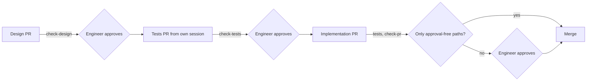

# Increment 02: trust core

## Goal

- A Go CLI `factory` checks skills, design notes, decision records, acceptance tests and the paths that a pull request changes.
- **An agent cannot approve.** Each increment has three pull requests: design note, tests, implementation. The engineer approves two of them, the design note and the tests, on a protected GitHub environment. The agent token cannot give that approval. A pull request that changes only paths on the project's list of approval-free paths merges without the engineer once all required checks pass. "Approved" means "merged on `main`".
- A pull request that changes tests, design notes or the domain model, CI or factory config changes nothing else. So the engineer sees each such change as its own pull request.
- Five skills carry the workflow: `designing-increments`, `writing-acceptance-tests`, `reviewing-increments`, `writing-pull-requests` and `writing-commit-messages`. `writing-acceptance-tests` and `reviewing-increments` run in their own sessions with fixed prompts. `writing-pull-requests` and `writing-commit-messages` follow rule 37 and the section "Pull requests" in `AGENTS.md`.
- `designing-increments` carries the formats of the design note and the domain model as templates. Before it designs a part, it searches for existing tools. It asks the engineer about terms, context boundaries and dependencies between contexts in rounds of numbered questions. Each question says what it is about and the consequences of each option. It finds facts itself and gives no recommended answers.
- The core of the factory imports no adapter (ADR 0001).
- Two new rules in `docs/principles.md`: a design names the existing tools it checked for each part, and building a part needs a reason; the engineer owns the terms, the context boundaries and the dependencies between contexts, and an agent stops and asks when an architecture check fails.
- The factory repo uses all of this from increment 03 on.

## Out of scope

- `factory install`, releases, the install step for cloud sessions and CI: increment 03
- an architecture check for a project's own language: increment 03
- acceptance tests in a project's own format; here, `testscript` tests the factory's own CLI, and `writing-acceptance-tests` and `check-tests` know only that format: increment 03
- receipts, the provenance log, holdout scenarios, checks for terms, one glossary per bounded context: later, see [backlog](../../backlog.md)
- adapters other than Claude Code

## Sketch

Where does the work stop until the engineer approves, and what is checked before each stop?



`check-pr` runs on every pull request. Design and tests pull requests always reach "Engineer approves", because their paths are in a group.

## Format

This section is the spec for the templates in the skills: `designing-increments` carries the design note and the domain model, `writing-acceptance-tests` carries the acceptance test and the runner.

**Design note**, `docs/increments/<nn>-<slug>/design.md`:

- Line 1 is `# Increment <nn>: <title>`. `<nn>` equals the folder's number.
- Required headings, exact text, any order: `## Goal`, `## Out of scope`, `## Existing tools`, `## Interface`, `## Scenarios`, `## Evidence`, `## Open questions`. Other headings are allowed.
- Each item under `## Open questions` says what it is about, so that a reader without context understands it, and names the consequences of each option. Implementation details are not open questions; the agent decides them.
- `## Existing tools` names, for each part that the increment builds, the tools that were checked, the decision (used, not used, later) and the reason. A part with no tool found names what was searched.
- The optional heading `## Domain` lists new or changed terms, the bounded contexts that the increment touches, and new dependencies between contexts. A new context or a new dependency between contexts also gets an architecture decision record.
- A scenario line matches `^- \*\*scenario (\d{2})\.([1-9]\d*)\*\* \((automated|demonstrated|manual)\) \*\*(.+?)[.?]\*\*`. `<nn>` equals the folder's number. The title is the third group. Any other line that starts with `- **scenario` is an error. Lines in fenced code blocks are ignored.

**Acceptance test**, `test/acceptance/<nn>-<slug>/scenario-<nn>.<n>.txtar`: a `testscript` file, one per automated scenario. Line 1 is `# scenario <nn>.<n>: <title>`, with the title exactly as in the note: same case, without the final period or question mark. Not allowed: `skip`, `stop`, and any condition in square brackets, such as `[net]` or `[darwin]`. Example:

```
# scenario 02.1: A valid skill passes
exec factory validate-skills skills
stdout '^validate-skills: ok 1 checked$'

-- skills/good-skill/SKILL.md --
---
name: good-skill
description: Does one thing. Use when testing.
---
```

How to read one: `exec` runs a command that must succeed. `! exec` runs one that must fail. `exitcode N factory …` runs `factory` and checks the exact exit code. `stdout '…'` and `stderr '…'` check for a line that matches the pattern. `exists path` checks that a file exists. Each `-- path --` starts a given file.

**Runner**, `test/acceptance/acceptance_test.go`: one file runs all test files. The test writer writes it in the tests pull request of this increment. It registers `factory` as a command, adds the command `exitcode` (because `testscript` checks only success or failure, not the exit code), sets `REPO` to the repo root (because each file runs in its own empty folder), and sets `HOME`, `GIT_CONFIG_NOSYSTEM=1` and a fresh temporary folder per file.

**Path groups.** A pull request that changes a path in a group changes no path outside that group:

| Group | Paths |
|---|---|
| tests | `test/acceptance/**`, `go.mod`, `go.sum` |
| design notes | `docs/increments/*/design.md`, `docs/domain/**` |
| CI and config | `.github/**`, `.factory/**` |

**Approval-free paths**, `.factory/approval-free-paths`: one path pattern per line, with `*` and `**` as in the path groups. A pull request needs no approval only when every path it changes matches a line, and no changed path is in a group. Without the file, every pull request needs approval.

**Domain model**, in the design-notes group. A project without bounded contexts yet has no domain model.

- `docs/domain/glossary.md`: line 1 is `# Glossary`. One line per term: `- **<Term>**: <definition>.`, optionally followed by `_Avoid_: <word> (<reason>), <word> (<reason>).`
- `docs/domain/context-map.md`: line 1 is `# Context map`. One `##` heading per bounded context, with the lines `- Folder: <path>`, `- Responsible for: <text>`, `- Not responsible for: <text>`, and one line `- Depends on: <context> (<pattern>)` per dependency. The patterns are those of DDD context mapping, for example open host service, anticorruption layer or conformist.

**Decision record**, `docs/decisions/<category>/<nnnn>-<slug>.md`, in the MADR format. The categories are `architecture` and `process`:

- Frontmatter is optional. Allowed fields: `date` (`YYYY-MM-DD`) and `status`. `status` is either `superseded by ADR-<nnnn>`, where record `<nnnn>` exists in the same category, or `deprecated`.
- The first heading is `# <title>`.
- Required `##` headings: `Context and Problem Statement`, `Considered Options`, `Decision Outcome`. Also allowed: `Decision Drivers`, `Pros and Cons of the Options`, `More Information`. No other `##` heading.
- Under `Decision Outcome`, the only `###` headings are `Consequences` and `Confirmation`. Under `Pros and Cons of the Options`, each `###` heading names an option.
- Lines in fenced code blocks are ignored.

**Skill fields**, from the Agent Skills specification:

- `name`: 1 to 64 characters; lowercase letters, digits and single hyphens; no hyphen at the start or end; equal to the folder name.
- `description`: 1 to 1024 characters.
- `compatibility`: at most 500 characters.
- `metadata`: a map of strings.
- Other allowed fields: `license`, `allowed-tools`.
- The fields `name` and `description` and the skill body must not name a specific agent tool: `claude`, `cursor`, `codex`, `copilot` or `gemini`, in any case. The field `compatibility` may name one, as the specification's own example does.

**Frontmatter subset** that `validate-skills` reads: `key: value`, quoted values, `|` and `>` blocks, and one nested map for `metadata`. Anything else is `unsupported-yaml`.

## Existing tools

| Part | Tools checked | Decision | Reason |
|---|---|---|---|
| Design-note format, `check-design`, `designing-increments` | GitHub Spec Kit and OpenSpec (both MIT); Kiro | not used | Spec Kit and OpenSpec would replace only `check-design` and part of one skill. Neither has a merge gate, tests from a separate session, or protected tests. Kiro is its own editor and CLI with its own credits and works with no other agent. |
| Approval flow | Swamp, extension `@swamp/software-factory` | not used | Every Swamp command except a few, such as `help` and `auth`, needs a swamp-club.com account; CI needs a token from that service. A `human-approval` decision is a record that any process with the CLI can write, so it does not stop an agent. |
| `validate-skills` | `skills-ref` from agentskills.io | not used | Its README: "This library is intended for demonstration purposes only. It is not meant to be used in production." |
| `check-adr` | adr-guard (.NET, MIT), adrscope (Rust, MIT) | not used | Each needs another runtime in the CI of every project; `check-adr` ships in the one `factory` binary (ADR 0001). adrscope expects structured MADR with its own frontmatter fields. |
| `check-pr` path groups | GitHub push rulesets, rule "Restrict file paths" | not used | GitHub offers push rulesets only for private and internal repositories. The factory repo is public. |
| `hook pre-tool-use` | Claude Code `permissions.deny` | not used | "An allow rule can't carve an exception out of a deny rule", so a project deny rule on the tests group would also block the test-writer session. |
| Acceptance tests | `testscript` from `github.com/rogpeppe/go-internal` (BSD-3-Clause) | used | The Go team's own script engine for testing the `go` command, factored out into a separate module. One readable file per scenario. A test-only dependency, which `AGENTS.md` allows. |
| Mutation score | Gremlins, go-mutesting | Gremlins used | Made for small Go modules like this one. It is before version 1.0; the score does not block a merge, so a fault in the tool blocks nothing. |
| Check that the core imports no adapter | go-arch-lint (MIT) | not used | One rule needs only `go list`. go-arch-lint fits a project with several rules. |
| Interview in `designing-increments` | skills `grilling` and `domain-modeling` by Matt Pocock (MIT) | idea used, files not used | Their frontmatter has fields outside the allowed skill fields. They give a recommended answer to each question, which the factory leaves out, so that the engineer decides instead of agreeing. |
| Domain model | Context Mapper (CML, Apache-2.0); ddd-crew Bounded Context Canvas (CC BY-SA 4.0) | later | Context Mapper needs a JDK and checks no TypeScript or Go code. The canvas pays off from the second bounded context. |

## Interface

Every output line starts with the command name and a colon, for example `check-pr:`. An error line is `<command>: error <where>: <code> <detail>`. `<where>` is a path, or `path:line` when the line is known. The last line is `<command>: ok <n> checked` or `<command>: <n> errors`. Exit codes: 0 ok, 1 errors, 2 usage or environment.

| Command | Codes |
|---|---|
| `factory validate-skills [dir ...]` | `name-mismatch`, `name-format`, `name-too-long`, `description-missing`, `description-too-long`, `compatibility-too-long`, `metadata-not-map`, `unknown-field`, `no-frontmatter`, `unsupported-yaml`, `tool-name` |
| `factory check-design <increment-dir>` | `bad-title`, `missing-section`, `bad-scenario-line`, `wrong-increment`, `duplicate-id` |
| `factory check-adr [dir]` | `unknown-category`, `unknown-field`, `bad-date`, `bad-status`, `unknown-adr`, `missing-title`, `missing-section`, `unknown-section`. Checks every `.md` file under `dir`, by default `docs/decisions`. A file outside the folders `architecture` and `process` is `unknown-category`. |
| `factory check-tests [--base <ref>]` | `missing-test`, `unknown-id`, `title-mismatch`, `forbidden-command`. Reads the design notes from `<ref>`, or from the working tree without `--base`. Reads the test files from the working tree. |
| `factory check-pr --base <ref>` | `mixed-pr`, with the paths of each group. Compares `HEAD` with its merge base with `<ref>`. Exit 2 with `shallow-clone`. Before the last line, prints `check-pr: approval required` or `check-pr: approval not required`, with `.factory/approval-free-paths` read from `<ref>`. |
| `factory hook pre-tool-use` | Reads Claude Code hook input on stdin: `tool_name`, `tool_input.file_path` or `tool_input.notebook_path`, `agent_type`, `agent_id`, `cwd`. Prints a deny decision as JSON, or nothing. |

**CI in the factory repo**, after this increment:

- Workflow `gate` on `pull_request_target`. GitHub then takes the workflow file and the checkout from `main`.
  - Job `checks` builds `factory` from `main`, fetches the pull request as data, and runs `check-pr`, `check-design` for each changed note, `check-adr` and `check-tests --base main`. It runs no code from the pull request and has no permissions. Its output `approval` is `not-required` only when all checks pass, `check-pr` prints `approval not required`, and the head branch is in the repo itself, not in a fork. Otherwise it is `required`.
  - Job `approval` runs after `checks` with `if: always()`, so it is never skipped; GitHub counts a skipped job as a passed required check. It uses the environment `no-approval`, which has no reviewers, only when the output of `checks` is `not-required`. In every other case, also when `checks` fails or sets no output, it uses the environment `approval`.
- Workflow `test` on `pull_request` runs `go test ./...`, which includes the acceptance tests. On a pull request that changes the tests group, each added test file must fail and every other test must pass, because the code for new tests does not exist yet. On any other pull request, all tests must pass. On a pull request that changes code, the job also mutates the code of `factory` with Gremlins, runs the acceptance tests against each mutant, and reports the mutation score in its summary. The score does not block a merge.
- The ruleset on `main` requires `checks`, `approval` and `test`.

## Scenarios

### Skill check

- **scenario 02.1** (automated) **A valid skill passes.** Given a skill with only allowed fields, `factory validate-skills` exits with 0.
- **scenario 02.2** (automated) **Invalid skills fail with a code.** Given one skill per skill-check code from the Interface, it exits with 1 and prints that code for that file.

### Design note check

- **scenario 02.3** (automated) **A note in the format passes.** Given a note that follows the Format, `factory check-design` exits with 0.
- **scenario 02.4** (automated) **A faulty note fails with a code.** Given one note per design-check code, it exits with 1 and prints the code with the line number.

### Test check

- **scenario 02.5** (automated) **One file per automated scenario passes.** Given a note and one test file per automated scenario, `factory check-tests` exits with 0.
- **scenario 02.6** (automated) **Wrong test files fail with a code.** Given one case per test-check code, it exits with 1 and prints the code and the id or file.
- **scenario 02.7** (automated) **Tests come before the implementation.** Given a note on the base branch whose test files are missing or deleted, `factory check-tests --base` exits with 1 with `missing-test`. Given a note that exists only in the working tree, it exits with 0.

### Pull request paths

- **scenario 02.8** (automated) **A pull request within one group passes.** Given a pull request that changes only a design note, or only test files and `go.mod`, or only paths outside all groups, `factory check-pr` exits with 0.
- **scenario 02.9** (automated) **A mixed pull request fails.** Given a pull request that changes code and a test file, or a test file and a design note, or code and a file under `.github/`, `factory check-pr` exits with 1 with `mixed-pr` and names the paths. Given a shallow clone, it exits with 2 with `shallow-clone`.
- **scenario 02.22** (automated) **Approval-free pull requests are recognized.** Given `.factory/approval-free-paths` with the line `internal/**` on the base branch, a pull request that changes only `internal/x.go` makes `factory check-pr` print `check-pr: approval not required`. It prints `check-pr: approval required` for a pull request that also changes `README.md`, for a base branch without the file, and for a list with the line `**` and a pull request that changes `test/acceptance/a.txtar`.

### Approval and credentials (manual, in the factory repo)

- **scenario 02.10** (manual) **Only a person approves.** A pull request cannot be merged before a required reviewer approves the `approval` job. After a new push, it needs a new approval. An attempt with the agent token to approve the job fails. A pull request that adds its own workflow with a job named `approval` that passes at once still cannot be merged, also when it first targets another branch and its base changes to `main` later. A pull request for which `check-pr` prints `approval not required` merges without a reviewer once `checks` and `test` pass. A pull request from a fork always waits for a reviewer.
- **scenario 02.11** (manual) **The gate comes from main.** A pull request that changes the `gate` workflow still runs the version from `main`, and its `checks` result shows on the pull request.
- **scenario 02.12** (manual) **Agent sessions cannot get around the gate.** From a local agent session, a push of a change under `.github/workflows/` fails, reading the repo's rulesets through the API fails, `gh auth token` and `git credential fill` fail, and the Read tool cannot read `~/.ssh`. From a cloud session, an attempt to approve the `approval` job through the API fails, and an attempt to change the ruleset through the API fails.
- **scenario 02.20** (manual) **New tests start red.** A tests pull request whose added test files pass, or that makes an existing test fail, cannot be merged. A tests pull request whose added test files fail, and whose other tests pass, can be merged.
- **scenario 02.21** (manual) **The strength of the acceptance tests is measured.** An implementation pull request shows, in the summary of the job `test`, the share of code mutants that the acceptance tests detect. A low share does not block the merge.

### Guard hook (early feedback, Claude Code adapter)

- **scenario 02.13** (automated) **Protected files.** Given hook input for `Write`, `Edit`, `MultiEdit` or `NotebookEdit` on a path in the tests group or the CI-and-config group, the hook prints a deny decision. The only exception: a write to `test/acceptance/` by a session started as `acceptance-test-writer`, with `agent_type` set and no `agent_id`.

### Skills

- **scenario 02.14** (automated) **The factory's skills are valid and tool-neutral.** `factory validate-skills "$REPO/core/skills"` exits with 0 (ADR 0001 confirmation).
- **scenario 02.15** (demonstrated) **Smoke run.** For each skill, one task runs once without and once with the skill, each in a fresh temporary repo without `AGENTS.md`, design notes or git history. The check command runs only afterwards. The recordings go to `evidence/`. This shows that the skill works, not how much it helps.
- **scenario 02.16** (manual) **Value in real use.** Over increment 03 and the first two increments of a project that uses the factory, `retro.md` counts the test writer's clarifying questions, tests changed after review, review findings, and the engineer's interventions. For each note, the engineer records yes or no, with a reason: was the note clear enough for the test writer?
- **scenario 02.17** (manual) **Review is recorded.** For increment 02 itself, `review.md` has the reviewer's findings on special cases, test detection, work outside the scenarios, and changed docs that contain their own history or elements outside their format, plus 2 or 3 comprehension questions with the engineer's answers.

### Architecture of the factory

- **scenario 02.23** (automated) **The core imports no adapter.** For each Go package outside `adapters/` and `cmd/`, `go list -deps` lists no package under `adapters/`.

### Decision record check

- **scenario 02.18** (automated) **A valid decision record passes.** Given a record in each category with only the allowed frontmatter fields and headings, `factory check-adr` exits with 0.
- **scenario 02.19** (automated) **A faulty decision record fails with a code.** Given one record per check code of `check-adr`, it exits with 1 and prints the code with the line number.

## Evidence

- **Approved scenarios:** 02.1 to 02.9, 02.13, 02.14, 02.18, 02.19, 02.22 and 02.23, as `testscript` files from the test-writer session, merged with the tests pull request.
- **Demonstrated:** 02.15.
- **Manual:** 02.10, 02.11, 02.12, 02.16, 02.17, 02.20 and 02.21.
- **Measurement, not evidence:** the mutation score from 02.21, recorded in `retro.md`.
- **ADR confirmation:** 02.14 and 02.23.
- **Not evidence:** unit tests from the implementing agent.

## Setup before the first pull request

These steps need a person with admin rights on the repo. [docs/setup/README.md](../../setup/README.md) lists them: repo settings, agent token, environment `approval`, approval workflow, ruleset, and the settings for local agent sessions.

After this increment, a CI pull request adds the jobs `checks` and `test` and makes them required. It also adds `.factory/approval-free-paths` with the paths of the Go code. Skills, docs and adapter settings are not on the list, because they steer the agents.

## Limits

- **Bootstrap:** this increment's pull requests run before `factory` exists on `main`. Until the CI pull request, only `approval` is required, and the engineer checks the paths with `git diff --stat`. The engineer reads `check-pr` and `check-tests` line by line in the review, because they guard all later pull requests.
- **One account:** agents act under the engineer's GitHub account, and GitHub cannot tell them apart. In local sessions, the guards are the missing token rights (Deployments, Workflows, Administration) and the sandbox. Cloud sessions use the engineer's own credentials through the GitHub proxy and can push workflow files. There the guards are the ruleset, which binds every account, and the approval, which needs a person. Scenario 02.12 checks both.
- **Guard hook:** it works only in Claude Code, and Bash can get around it. It gives early feedback only.
- **Merge without approval:** for such a pull request, the review, the demonstrated scenarios and the manual scenarios run after the merge. A finding becomes a fix in a new pull request. The approved tests are the only guard before the merge, so code that detects a test run is caught only after the merge. See open question 1.
- **Break glass:** the engineer can switch off the ruleset in the settings, for example for an urgent fix while a design note on `main` has no tests yet. The next retro records each use.

## Open questions

1. **Review before a merge without approval:** all agents act under one account. So a review result that an agent session writes into the pull request cannot be told apart from one that the implementing agent writes. Either the review runs as a CI job from `main`, with an agent CLI and its token as a secret, and its result is a required check. Or the review runs after the merge, as in the limit "Merge without approval". Which one?
