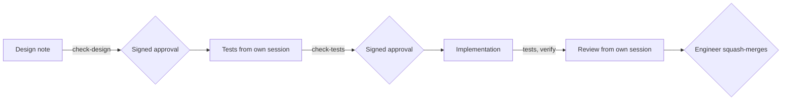

# Increment 02: trust core

Status: proposed

## Goal

- A Go CLI `factory` checks skills, design notes and acceptance tests.
- **An agent cannot approve.** The engineer approves a design note or a set of tests with a commit on the pull request branch, signed with a Touch ID key. A required check verifies the signature before the squash merge.
- Three skills carry the workflow: `designing-increments`, `writing-acceptance-tests` and `reviewing-increments`. The second and third run in their own sessions with fixed prompts.
- The factory repo uses all of this from increment 03 on.

## Out of scope

- `factory install`, releases, the install step for cloud sessions and CI, the ruleset: increment 03
- the provenance log, the workflow gate, holdout scenarios: later, when `health` needs them
- adapters other than Claude Code

## Sketch

Where does the work stop until the engineer approves, and what is checked before each stop?



## Format

**Design note**, `docs/increments/<nn>-<slug>/design.md`:

- Line 1 is `# Increment <nn>: <title>`. Line 3 is exactly `Status: proposed`. A note never says `approved`; an approval exists only as a signed approval commit.
- Required headings, exact text, any order: `## Goal`, `## Out of scope`, `## Interface`, `## Scenarios`, `## Evidence`, `## Open questions`.
- A scenario line matches `^- \*\*scenario (\d{2})\.([1-9]\d*)\*\* \((automated|demonstrated|manual)\) \*\*(.+?)[.?]\*\*`. The `<nn>` equals the folder's number. Any other line that starts with `- **scenario` is an error.

**Acceptance test**, `test/acceptance/<nn>-<slug>/scenario-<nn>.<n>.txtar`: a `testscript` file, one per automated scenario. Line 1 is `# scenario <nn>.<n>: <title>`. `skip`, `stop` and `[net]` are not allowed. Example:

```
# scenario 02.1: a valid skill passes
exec factory validate-skills skills
stdout '^skills: 1 checked, 0 with errors$'

-- skills/good-skill/SKILL.md --
---
name: good-skill
description: Does one thing. Use when testing.
---
```

How to read one: `exec` runs a command that must succeed. `! exec` runs one that must fail. `exitcode N` checks the exact exit code. `stdout '…'` checks for a line that matches the pattern. `exists path` checks that a file exists. Each `-- path --` starts a given file.

One runner, `test/acceptance/acceptance_test.go`, runs all files. It sets `HOME`, `GIT_CONFIG_NOSYSTEM=1`, and a fresh temporary folder per file. The engineer reviews the runner once.

**Approval record**, `docs/increments/<nn>-<slug>/approvals.json`:

```json
{
  "design": { "reviewedCommit": "<sha>", "sha256": "<hash of design.md at that commit>" },
  "tests": { "reviewedCommit": "<sha>", "designSha256": "<hash>", "files": { "<path>": "<hash>" } }
}
```

**Frontmatter subset** that `validate-skills` reads: `key: value`, quoted values, `|` and `>` blocks, and one nested map for `metadata`. Anything else is `unsupported-yaml`.

## Interface

Every error line has the form `<prefix>: error <where>: <code> <detail>`. Exit codes are 0 ok, 1 errors, 2 usage or environment.

| Command | Codes |
|---|---|
| `factory validate-skills [dir ...]` | `name-mismatch`, `name-format`, `name-too-long`, `description-missing`, `description-too-long`, `compatibility-too-long`, `metadata-not-map`, `unknown-field`, `no-frontmatter`, `unsupported-yaml` |
| `factory check-design <increment-dir>` | `missing-section`, `bad-status`, `bad-scenario-line`, `wrong-increment`, `duplicate-id` |
| `factory check-tests <increment-dir>` | `missing-test`, `unknown-id`, `title-mismatch`, `forbidden-command` |
| `factory approve <increment-dir> design\|tests --commit <sha>` | prints the files and hashes it approves, then creates a signed commit that changes only `approvals.json`. Refuses (exit 1) with `dirty-tree`, or with `design-changed` when the tests approval finds a design hash that differs. |
| `factory verify --pr <base-ref>` | `unsigned`, `unknown-signer`, `extra-paths`, `merge-commit`, `hash-mismatch`, `missing-approval`, `design-changed`, `approval-deleted`; exit 2 with `shallow-clone` |
| `factory verify` (on `main`) | `hash-mismatch`, `missing-approval`, `approval-deleted` |
| `factory hook pre-tool-use` | reads hook input on stdin; prints a deny decision as JSON, or nothing |

The signers are the engineer's SSH signing keys on GitHub, from `GET /users/<login>/ssh_signing_keys`. `<login>` comes from `.factory/config.json`. CI builds `factory` from the base branch, never from the pull request.

## Scenarios

### Skill check

- **scenario 02.1** (automated) **A valid skill passes.** Given a skill with only standard fields, `factory validate-skills` exits with 0.
- **scenario 02.2** (automated) **Invalid skills fail with a code.** Given one skill per skill-check code from the Interface, it exits with 1 and prints that code for that file.

### Design note check

- **scenario 02.3** (automated) **A note in the format passes.** Given a note that follows the Format, `factory check-design` exits with 0.
- **scenario 02.4** (automated) **A faulty note fails with a code.** Given one note per design-check code, it exits with 1 and prints the code with the line number.

### Test check

- **scenario 02.5** (automated) **One file per automated scenario passes.** Given a note and one test file per automated scenario, `factory check-tests` exits with 0.
- **scenario 02.6** (automated) **Wrong test files fail with a code.** Given one case per test-check code, it exits with 1 and prints the code and the id or file.

### Approve and verify

The tests use a temporary repo, a test key without Touch ID, and a local file instead of the GitHub key list.

- **scenario 02.7** (automated) **A signed approval passes.** Given an approval commit signed by a listed key that changes only `approvals.json`, and unchanged approved files, `factory verify --pr` exits with 0.
- **scenario 02.8** (automated) **A forged approval fails.** Given an approval commit that is unsigned, signed by an unlisted key, a merge commit, or one that changes another file, `factory verify --pr` exits with 1 with `unsigned`, `unknown-signer`, `merge-commit` or `extra-paths`.
- **scenario 02.9** (automated) **A change after approval fails.** Given a signed approval, when an approved file changes afterwards or a test file has no approval, `factory verify --pr` exits with 1 with `hash-mismatch` or `missing-approval`.
- **scenario 02.10** (automated) **Tests need the approved design.** Given a design that changed after its approval, `factory approve … tests` exits with 1 with `design-changed`, and `factory verify --pr` exits with 1 with `design-changed`.
- **scenario 02.11** (automated) **Deleted approvals and shallow clones are caught.** Given a branch that deletes `approvals.json`, `factory verify --pr` exits with 1 with `approval-deleted`. Given a shallow clone, it exits with 2 with `shallow-clone`.
- **scenario 02.12** (automated) **main stays consistent.** Given `main` after a squash merge, `factory verify` exits with 0. When an approved file is edited on `main`, it exits with 1 with `hash-mismatch`.
- **scenario 02.13** (manual) **Touch ID approves.** On the Mac, `factory approve` shows the files and hashes, then asks for Touch ID. The required check passes, and the squash merge keeps the approved content.

### Guard hook (early feedback, Claude Code adapter)

- **scenario 02.14** (automated) **Protected files.** Given hook input for a write to `test/acceptance/`, an `approvals.json`, `.factory/` or `.github/`, the hook prints a deny decision. The only exception: a write to the increment's test folder by a session started as `acceptance-test-writer` (agent type set, no agent id), while no tests approval exists.

### Skills

- **scenario 02.15** (automated) **Skills are valid and tool-neutral.** `factory validate-skills core/skills` exits with 0, and no file under `core/` or in the tool-neutral packages names an agent tool (ADR 0001 confirmation).
- **scenario 02.16** (demonstrated) **Smoke run.** For each skill, one task runs once without and once with the skill, each in a fresh temporary repo without `AGENTS.md`, design notes or git history. The check command runs only afterwards. The recordings go to `evidence/`. This shows that the skill works, not how much it helps.
- **scenario 02.17** (manual) **Value in real use.** Over increment 03 and the first two `health` increments, the engineer rates the notes and tests from the skills from 1 to 5 on four criteria: unambiguous scenarios, enough interface for the test writer, readable, nothing missing. Also counted: the test writer's clarifying questions, tests changed after review, and interventions.
- **scenario 02.18** (manual) **Review is recorded.** For increment 02 itself, `review.md` has the reviewer's findings on special cases, test detection and work outside the scenarios, plus 2 or 3 comprehension questions with the engineer's answers.

## Evidence

- **Approved scenarios:** 02.1 to 02.12, 02.14 and 02.15, as `testscript` files from the test-writer session, approved with a signature.
- **Demonstrated:** 02.16.
- **Manual:** 02.13, 02.17 and 02.18.
- **ADR confirmation:** part of 02.15.
- **Not evidence:** unit tests from the implementing agent.

## Setup before the first approval

1. A fine-grained token for agents: Contents and Pull requests write, nothing else. No Administration, Workflows or Deployments. Claude Code gets it through its settings. The sandbox denies reading the engineer's own credentials.
2. In Secretive: a key used only for approvals, with Touch ID on every use and without remembering authentication. Its public key is added on GitHub as an SSH signing key.
3. `.factory/config.json` on `main` names the engineer's GitHub login.

## Limits

- **Bootstrap:** increment 02's own pull request cannot use a `factory` built from `main`, because `main` has none yet. Its approvals use plain `git commit -S` with the Touch ID key. Before the merge, the engineer runs `factory verify --pr`, built from the reviewed commit.
- **Blind signing:** Touch ID does not show what is signed. `factory approve` prints it first. The engineer touches only for an approval the engineer started.
- **Guard hook:** it works only in Claude Code, and Bash can get around it. The real checks are the verify run and the token without workflow rights.

## Open questions

1. **Trust root:** the GitHub signing keys of the engineer's account replace a signers file in the repo. A lost Mac then needs only a new key on GitHub. Is that right?
2. **Test dependency:** `testscript` (`github.com/rogpeppe/go-internal`) as a test-only dependency. Is that right?
3. **Agent commits** stay unsigned. Only approvals are signed. Is that right?
