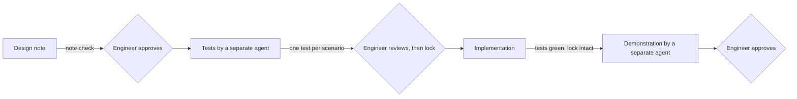

# Increment 02: skills and checks for the increment workflow

Status: proposed, waiting for the engineer's approval.

## Goal

- Two skills carry the workflow, so that `AGENTS.md` keeps only the rules:
  - `designing-increments` writes a design note.
  - `writing-acceptance-tests` writes the black-box tests for approved scenarios. A separate agent with a fresh context uses it.
- Scripts check what the skills produce. The skills hold the judgment, and the scripts hold the structure that a machine can check (rule 2).
- A test lock and a guard hook keep the implementing agent away from the acceptance tests (rule 29).
- The factory repo uses all of this for its own increments, starting with increment 03.

## Out of scope

- the full lock with a provenance log and a workflow gate: increment 04
- `install.mjs`, CI, ruleset: increment 03
- Gherkin `.feature` files. The factory writes its scenarios in Markdown. Project formats come when `health` needs them.

## Sketch

Where does the work stop until the engineer approves, and what is checked before each stop?

## Interface

The tests use only these commands and outputs. Every output line starts with the prefix shown.

| Command | Exit code | Output on error |
|---|---|---|
| `node core/scripts/validate-skills.mjs [dir ...]` | 0 ok, 1 errors | `skills: error <file>: <reason>` |
| `node core/scripts/check-design-note.mjs <increment-dir>` | 0 ok, 1 errors | `design: error <file>:<line>: <problem>` |
| `node core/scripts/check-acceptance-tests.mjs <increment-dir>` | 0 ok, 1 errors | `tests: error <id or file>: <problem>` |
| `node core/scripts/lock-tests.mjs <increment-dir>` | 0 ok | writes `<increment-dir>/tests.lock` |
| `adapters/claude-code/hooks/guard-acceptance-tests.mjs` (hook input on stdin) | 0 | a deny decision as hook JSON, with a reason |

- An increment `docs/increments/<nn>-<slug>/` has one test file: `test/acceptance/<nn>-<slug>.test.mjs`.
- Each test title starts with `scenario <nn>.<n>:`.

## Scenarios

Each scenario names how it is verified:
- **automated:** a black-box test written by a separate agent
- **demonstrated:** a separate agent runs it and records it, and the engineer views the recording
- **manual:** the engineer runs it

### Skill check

- **scenario 02.1** (automated) **Valid skill.** Given a skill that uses only the standard fields, when `validate-skills.mjs` runs, then the exit code is 0.
- **scenario 02.2** (automated) **Invalid skills.** Given one skill per case below, when `validate-skills.mjs` runs, then it exits with 1 and prints one error line per case with the file and the reason:
  - the name differs from the folder name
  - the name has an uppercase letter, a double hyphen, or a hyphen at the start or end
  - no description, or a description longer than 1024 characters
  - a field outside the standard
  - no frontmatter

### Design note check

- **scenario 02.3** (automated) **Complete note.** Given a note with a status line, the sections Goal, Out of scope, Scenarios, Evidence and Open questions, and scenario ids that match the increment number, each with a verification kind, when `check-design-note.mjs` runs, then the exit code is 0.
- **scenario 02.4** (automated) **Faulty note.** Given one note per case below, when `check-design-note.mjs` runs, then it exits with 1 and names the problem:
  - a missing section
  - an id with the wrong form or another increment number
  - an id that appears twice
  - a scenario without a verification kind
  - more than 200 lines
  - a Mermaid sketch with more than 7 nodes

### Acceptance test check

- **scenario 02.5** (automated) **One test per automated scenario.** Given a note and its test file with exactly one test per automated scenario, when `check-acceptance-tests.mjs` runs, then the exit code is 0. Demonstrated and manual scenarios need no test.
- **scenario 02.6** (automated) **Missing or extra tests.** Given one case below, when `check-acceptance-tests.mjs` runs, then it exits with 1 and names the id:
  - an automated scenario without a test
  - a scenario with two tests
  - a test with an id that is not in the note

### Test lock

- **scenario 02.7** (automated) **Lock holds.** Given an increment with tests, when `lock-tests.mjs` runs and then `check-acceptance-tests.mjs` runs, then `tests.lock` lists a hash for the test file, and the check exits with 0.
- **scenario 02.8** (automated) **Changed tests are found.** Given a locked increment, when the test file is changed or removed, then `check-acceptance-tests.mjs` exits with 1 and names the file.
- **scenario 02.9** (automated) **Code must not know the tests.** Given a locked increment, when a file outside `test/` and `docs/` contains one of its scenario ids or the text `test/acceptance`, then `check-acceptance-tests.mjs` exits with 1 and names that file.

### Guard hook (Claude Code adapter)

- **scenario 02.10** (automated) **Main agent cannot write tests.** Given hook input for a write by the main agent to `test/acceptance/` or to a `tests.lock`, then the hook returns a deny decision with a reason.
- **scenario 02.11** (automated) **Test agent writes only before the lock.** Given hook input for a write by the agent `acceptance-test-writer` to its increment's test file, then the hook allows it while the increment has no `tests.lock`, and denies it after.
- **scenario 02.12** (automated) **Test agent cannot read the implementation.** Given hook input for a read by `acceptance-test-writer` under `core/scripts/`, `adapters/` or of `install.mjs`, then the hook returns a deny decision.

### The skills

- **scenario 02.13** (automated) **Skills are valid and tool-neutral.** Given both skills under `core/skills/`, then `validate-skills.mjs` exits with 0, and no file under `core/` names an agent tool (ADR 0001 confirmation).
- **scenario 02.14** (automated) **The factory finds its own skills.** Given the factory repo, then `.claude/skills/<name>` and `.agents/skills/<name>` exist for both skills, each a link to `../../core/skills/<name>`.
- **scenario 02.15** (demonstrated) **`designing-increments` helps.** A separate agent writes 3 design notes, each once without and once with the skill: increment 03, a small feature in a fixture project, and a bug fix in a fixture project. With the skill, all 3 notes pass `check-design-note.mjs`. The recordings show both runs per task.
- **scenario 02.16** (demonstrated) **`writing-acceptance-tests` helps.** A separate agent writes tests for 3 approved fixture notes, each once without and once with the skill. With the skill, all 3 pass `check-acceptance-tests.mjs`. The recordings show both runs per task.
- **scenario 02.17** (manual) **Usable in real work.** In increment 03, the engineer confirms that the design note and the tests made with the skills are usable.

## Evidence

- **Approved scenarios:** 02.1 to 02.14, as tests that a separate agent wrote and the engineer reviewed.
- **Demonstrated:** 02.15 and 02.16, as recordings in `docs/increments/02-workflow-skills/evidence/`.
- **Manual:** 02.17.
- **ADR confirmation:** part of 02.13.
- **Not evidence:** any unit tests the implementing agent writes.

## Limits

- The guard hook works only in Claude Code. In other tools, only the lock check holds, and it runs in CI.
- A Bash command can still change a test file locally. The lock check in CI finds that. The ruleset from increment 03 then blocks the merge.

## Open questions

1. **Status line:** only the engineer sets `Status: approved`, the same as `accepted` in an ADR. Is that right?
2. **Test runner:** `node:test`, built into Node, so there is no dependency. Is that right?
3. **Scenario format:** Markdown, not Gherkin. Is that right?
4. **Who locks:** the engineer runs `lock-tests.mjs` after the review, in the engineer's own terminal. Is that right?
