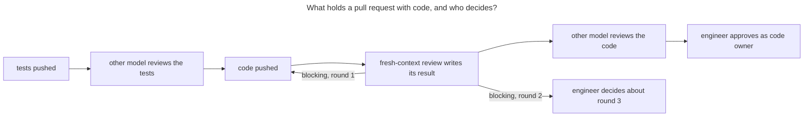

# Increment 06: gate and status

## Goal

- `factory status` shows, from the repo alone, where each increment stands and what waits for the engineer: missing tests, a code commit without a review result, open manual and demonstrated scenarios, a missing retro. The README points to it instead of restating the state.
- The engineer records the result of each manual and demonstrated scenario, and each merge while a check of the pull request failed, in `evidence/<nn>-<slug>/results.md`, a file that the engineer owns.
- The result of the fresh-context review holds the merge. Each finding is `blocking` or `note`, and the job `checks` fails while the latest code commit has no review result or its result has a blocking finding. After two review rounds with a blocking finding on one branch, the engineer decides about a third.
- In the factory repo, the engineer owns every path that judges a pull request: the CLI, the adapter, the skills and the test runner, besides `.github/` and `.factory/`. So no pull request changes the checks for the next one without the engineer.
- The commands decide which check applies to a pull request, and the workflows only call them: `check-design` finds the changed notes itself, and `cross-review` chooses between a review of the design note, of the tests, of the code, or none.
- The other model reviews the tests while they can still change: before the first code commit.
- The acceptance run names the functions that no acceptance test reaches.

## Out of scope

- The rulesets on GitHub. Today the ruleset `main` requires neither a code owner review nor a check. The engineer turns both on with `factory setup` once this increment is merged; `factory setup --dry-run` shows the difference.
- The job `tests-start-red`: increment 05 changes it, and it stays in the workflow.
- New evidence for the skills: increment 02 demonstrated two of six skills (scenario 02.15), on a smaller model than the sessions use, and 75 of 92 graders judge a trace of which the judge sees only the start and the end. A rerun on the session model, with three runs per case and graders that match tool calls, costs about 100 eval runs. The engineer decides when.
- `check_sources` of the skill `authoring-skills` in CI, and with it the end of the hook that asks a session to load that skill before it changes a skill. The script compares a skill with the repo that it describes; in the factory repo every skill is part of that repo, and the script reports 1 to 27 lines per skill as copies of themselves. The hook stays until the script can tell the two apart.
- The sandbox host list in `adapters/claude-code/user-settings.json`, which repeats `.factory/allowed-hosts`: `factory install` (increment 07) writes both from one list.
- A generated view of the interface and the scenarios in force: increment 08, docs for people.
- A mutation score: stays in `docs/backlog.md` with its trigger.

## Domain

- Terms: none; the factory has no glossary yet.
- Contexts: none.
- Dependencies: none.

## Sketch

## Existing tools

Sources: [research/2026-11-factory-review.md](../../research/2026-11-factory-review.md), which also records which of its claims were checked against the original pages.

| Part | Checked | Decision | Reason |
|---|---|---|---|
| State of the increments | the status table in the README; GitHub pull request lists (`gh pr list`); a journal and stage records as in Swamp's software-factory extension; the state derived from git and the files | derived from git and the files | The README rows of increments 02, 04 and 05 went stale after their merge. A journal is a second store that can go stale too. `gh` needs a token and the network. The notes, test files, review results and retros already hold each fact. |
| Records of manual and demonstrated results | pull request comments; GitHub check runs; Swamp's gates `evidence-recorded` and `human-approval`; one file per increment | one file per increment, owned by the engineer | Comments and check runs are not in the repo, so `factory status` cannot read them and the engineer cannot own them. A line in an owned file needs the engineer's approval to reach `main`. |
| Severity of review findings | the severities `blocking` and `note` of `factory cross-review`; Swamp's gate `findings-clear` with `blocking: [critical, high]`; Claude Code best practices: "A reviewer that's asked to find problems will always find *something*", so the prompt says what to skip | `blocking` and `note` | The same two words as the other model's review. A third level adds a choice without a different consequence. |
| Cap on review rounds | no cap, as today; Swamp's `maxCycles`, 5 by default, after which a run waits for a person | two rounds, then the engineer | Increment 04 took seven reviewer rounds, and its retro calls the findings from the third round on doubtful. |
| Owned trust roots | GitHub code owners with "Require review from Code Owners", which reads `CODEOWNERS` from the base branch, where the last matching pattern wins; a separate review of trust-root changes, as at Swamp | code owners | Already in use for `.github/` and `.factory/`. Because the base branch decides, a pull request cannot remove its own owner. |
| Which check applies | shell and `sed` in the workflows, as today; the commands | the commands | The shell repeats `paths.Code` and `paths.GroupOf` in the most trusted place, without a test, and the engineer reviews a `sed` program by eye. |
| Review of the tests | the reviewer after the code, as today; the other model at the end of the test phase | the other model at the end of the test phase | After the first code commit, `check-pr` lets no test change; in increment 03 a wrong test needed a new branch. |
| Coverage of the acceptance run | `go build -cover` with `GOCOVERDIR`, then `go tool covdata textfmt` and `go tool cover -func` (Go 1.20 and later); mutation tools for Go | `go build -cover` | Part of the Go toolchain, no new dependency. Mutation tools mutate only what the coverage of `go test` reaches, and the acceptance tests run a separately built binary. |

## Interface

**`factory status`** reads the working tree at the root of the repo, for each design note under `docs/increments/`, in the order of the folders. It prints, for each increment, `status: <nn>-<slug> <stage>`, where `<stage>` is the first of these that applies:

- `tests`: an automated scenario in force has no test file under `test/acceptance/<nn>-<slug>/`.
- `review`: `evidence/<nn>-<slug>/review.md` is missing, or its Result line names one or more blocking findings.
- `results`: a manual or demonstrated scenario in force has no result `passed` in `evidence/<nn>-<slug>/results.md`.
- `retro`: `docs/increments/<nn>-<slug>/retro.md` is missing.
- `done`.

After the stage line, it prints one line for each open point of the increment, whatever its stage: `status: <nn>-<slug> missing-test <id>`; `status: <nn>-<slug> missing-review`; `status: <nn>-<slug> blocking-review <b>`; `status: <nn>-<slug> waits-for-engineer <id> <kind>` for a manual or demonstrated scenario without a result; `status: <nn>-<slug> failed <id>` for one whose latest result is `failed`; `status: <nn>-<slug> missing-retro`. When the branch has a code commit without a review result, by the rule of the stop hook, it then prints `status: review-open <full hash>`. The last line is `status: ok <n> checked`, with the number of increments, or `status: <k> errors`. A result line in another form is the error `status: error <path>:<line>: bad-result-line`, and a result for an id that is not a manual or demonstrated scenario in force of that note is `status: error <path>:<line>: unknown-scenario <id>`. Exit codes: 0 without errors, 1 with errors, 2 for a usage problem.

**Results file** `evidence/<nn>-<slug>/results.md`, written by the engineer, or by an agent from the engineer's words in a pull request that the engineer approves. Any heading and prose are allowed. Each line that starts with `- ` matches one of:

- `^- (\d{2}\.[1-9]\d*) (passed|failed) (\d{4}-\d{2}-\d{2}): (.+)$`: a scenario, its result, the date, and what the engineer ran or viewed. A later line for the same id replaces an earlier one.
- `^- break-glass (\d{4}-\d{2}-\d{2}) (\S+): (.+)$`: a merge while a check of the pull request failed, with the date, the link of the pull request, the check and the reason.

**Review result** `evidence/<nn>-<slug>/review.md`, as in increment 04, with these changes: the Result line is `Result: <b> blocking, <n> notes`, with the word `notes` also for 1. Under `## Findings`, up to the next heading, each finding is a line that starts with `- **blocking**` or `- **note**`. A finding is blocking only when the change is wrong, a test does not test its scenario, code detects a test run or hard-codes a test case, a protected path changes after the test phase, or a check fails; every other finding is a note. The reviewer reports no finding about the wording of a retro or the README.

**`factory check-review --base <ref>`** reads the commits of the branch as `check-pr` does. The latest code commit is the latest commit that changes a path that counts as code, by the rule of the stop hook.

- Without a code commit, it prints `check-review: no code change` and `check-review: ok 0 checked`.
- Otherwise the review result is the file `evidence/*/review.md` in the working tree that names the full hash of that commit. Without one: `check-review: error <hash>: missing-review`.
- With one, it prints `check-review: reviewed <hash> in <file>, round <k>`, where `<k>` is the number of commits of the branch that add or change that file. Then, as errors on `<file>`: `bad-result` when the Result line is missing or has another form; `result-mismatch` when the counts of the Result line differ from the finding lines; `blocking <b>` when `<b>` is greater than 0, and from round 2 on its detail ends with `after 2 rounds the engineer decides`.
- The last line is `check-review: ok 1 checked` or `check-review: <k> errors`. Exit codes as for `status`.

**`factory check-design --base <ref>`** checks each design note under `docs/increments/` that the branch adds or changes against its merge base with `<ref>`, each as `factory check-design <increment-dir>` does, with the same error lines. The last line counts the scenarios of all checked notes, and is `check-design: ok 0 checked` when no note changes. `factory check-design <increment-dir>` is unchanged.

**`factory cross-review --base <ref>`**, as in increments 02 and 05, chooses the review from the paths that the branch changes against its merge base:

- **design**, when it changes a design note or a path under `docs/domain/`: as before, but a blocking finding does not make the command fail; the last line is `cross-review: ok`.
- **tests**, when it changes no design note, and every path that counts as code is in the tests group: the request holds the design notes of the increments that the pull request belongs to (rule of increment 05), the titles of their scenarios in force, and the diff. Its instructions ask whether each test checks what its scenario says, including each case where something must not happen. A finding is blocking only when a test would pass without the behaviour of its scenario, or would fail for a correct implementation. The command does not wait for a review result.
- **code**, when it changes a path that counts as code outside the tests group: while the latest code commit has no review result, it sends nothing, prints `cross-review: waiting for a review result for <full hash>` and `cross-review: blocking`, and exits 1. Otherwise as in increment 05.
- **none**, otherwise: it sends nothing and needs no key; it prints `cross-review: does not apply: no design note and no code change` and `cross-review: ok`.

When it sends a request, its first line is `cross-review: model <model>`, with the model for that review from `.factory/cross-review.json` on `<ref>`: `design` for a design review, `code` for the tests and the code.

**Acceptance run.** `go test ./test/acceptance/` builds `factory` with coverage of the packages of the module, runs each script with its coverage data written to one folder, and after the run prints `acceptance: coverage 
% of statements` and one line `acceptance: uncovered <file>:<line> <function>` for each function that no script reached. The results of the tests do not change.

**Workflows**, in their own commit of the group CI and config. `checks` builds `factory` from `main` and calls `check-pr`, `check-adr`, `check-design --base`, `check-tests --base` and `check-review --base`, each as one step, and every step runs also after a failed one. `cross-review` calls `factory cross-review --base`, and, when it sent a request, posts its output as a comment headed with the model of its first line. Without a request, as when it waits for the review result or the review does not apply, the job log holds the reason.

**Owned paths.** `.github/CODEOWNERS` adds `/cmd/`, `/internal/`, `/adapters/`, `/.claude/`, `/core/`, `/test/` and `/evidence/*/results.md`.

**Rules.** In `docs/principles.md` and `AGENTS.md`:

- Rule 12 names `factory check-review` as its check, and states that the implementing session can write a review result itself: the engineer's approval of the code, as code owner, is what holds in the factory repo.
- Rule 13 takes the severities, the two rounds, the review of the tests before the code, and no review by the other model without a design note or code.
- Rule 28 states that CI checks the order of tests and code, not which session wrote the tests: all sessions push as one account.
- Rule 34 covers the CLI, the adapter, the skills and the test runner, and the checks for the next pull request.
- A new rule: the results file, with its source, the nine manual and demonstrated scenarios of increments 02 to 04 that have no recorded result.
- "Enforced by" gets a clock: a rule that is still "not enforced" after two retros names its check and increment, moves to the backlog with a trigger, or becomes a principle, which says so in "Enforced by" and keeps its re-check. The retro of this increment applies it.
- The entries "planned (CI pull request of increment 02)" name what is on `main` and what the ruleset does not yet require.
- `AGENTS.md`: the pull request opens as a draft once the tests are pushed, so that the other model reviews them; after two review rounds with a blocking finding, the agent stops and asks the engineer; the engineer writes the results file; the retro has a table with one row per review source: findings, findings that changed code or a note, and cost.
- The README: the next step after this increment is one increment of a project, `health`, with a hand copy of the skills and workflows; until then no new rule without an observed failure. The later increments become 07 install and distribution, 08 docs for people, 09 handover.

## Scenarios

In scenarios 06.1 to 06.3, the repo holds the design notes of increments 07, 08 and 09. In scenarios 06.3 to 06.12 and 06.15, a pull request is a branch from `main`, and a file under `internal/` is code, as `.factory/code-paths` on `main` says. A review result is a file `evidence/<nn>-<slug>/review.md` that names the full hash of a commit.

- **scenario 06.1** (automated) **Status shows where each increment stands.** Increment 07 has an automated scenario with its test file, a manual scenario with a result `passed`, a review result without a blocking finding, and a retro: it is done. Increment 08 has two automated scenarios, and only the first has a test file: it waits for tests, and the output names the second scenario. Increment 09 has its test file and a review result, but its demonstrated scenario has no result and it has no retro: it waits for results, and the output names the demonstrated scenario as waiting for the engineer, and the missing retro.
- **scenario 06.2** (automated) **A failed or malformed result keeps an increment open.** The results file of 07 has a result `passed` for its manual scenario and, in a later line, a result `failed` for it: 07 waits for results, and the output names the scenario as failed. Status rejects a results file with the line `- 07.2 done yesterday`, and one with a result for 07.1, which is automated, and names the file and line of each.
- **scenario 06.3** (automated) **Status names the code commit that waits for a review.** A commit on the branch changes a code file, and no review result names it: the output names that commit. After a commit that adds a review result naming it, the output names no commit.
- **scenario 06.4** (automated) **A blocking finding holds the merge, a note does not.** A branch has a code commit and a review result that names it. With one blocking finding and a Result line that counts it, `check-review` rejects the pull request. With two notes and no blocking finding, it passes.
- **scenario 06.5** (automated) **A missing review result holds the merge.** A branch whose latest code commit no review result names is rejected, and the output names that commit; a review result that names an earlier code commit of the branch does not count. A branch that changes only `README.md` passes, and the output says that it has no code change.
- **scenario 06.6** (automated) **The Result line must match the findings.** A review result whose Result line counts no blocking finding, but whose findings hold one, is rejected. So is a review result with the Result line `Result: no findings`.
- **scenario 06.7** (automated) **After two rounds, the engineer decides.** A branch has two commits that change its review result, and the second still holds a blocking finding: the pull request is rejected, and the output names round 2 and says that the engineer decides. With only one such commit, the output names round 1 and does not mention the engineer.
- **scenario 06.8** (automated) **check-design checks each note that a pull request changes.** `main` holds a correct note of 07. A branch changes that note, which stays correct, and adds a note of 08 without the section Goal: the check with a base rejects the note of 08 and nothing in the note of 07. A branch that changes no note passes, with 0 checked.
- **scenario 06.9** (automated) **The other model gets the notes of the pull request's own increments, and nothing without code.** `main` holds the notes of 07, with its test files, and of 08, and a stand-in for the other model keeps each request. A pull request that changes a code file and adds a review result for that commit under `evidence/07-sample/` is sent with its diff and the note of 07, and with neither the note of 08 nor a scenario title of 08. One that also adds a file under `evidence/08-later/` is sent with both notes. One that changes only `README.md` is not sent, passes, and runs without a key.
- **scenario 06.10** (automated) **The other model waits for the review result.** A pull request whose latest code commit no review result names is not sent; the command fails and names the commit. After a commit that adds a review result for it, the pull request is sent.
- **scenario 06.11** (automated) **The other model reviews the tests before the code.** A pull request that adds only a test file of increment 08 is sent with the note of 08, its scenario titles and the diff, and with instructions that ask whether each test checks what its scenario says. No review result names the test commit, and the request is sent all the same.
- **scenario 06.12** (automated) **The model heads the review, and a design note is never held.** A pull request that changes a design note gets output whose first line names the model for design reviews in `.factory/cross-review.json` on `main`, and a blocking finding of the stand-in does not make the command fail. A pull request with code gets the model for code reviews in its first line.
- **scenario 06.15** (automated) **A blocking finding of the other model holds code.** A pull request has a code commit and a review result for it. With a stand-in that reports one blocking finding, `cross-review` prints the finding and fails. With a stand-in that reports only notes, it prints them and passes. When the model cannot be reached, or answers in another form, it fails.
- **scenario 06.13** (demonstrated) **The acceptance run names what no test reaches.** The review session runs the acceptance tests and records the coverage line and the functions that no script reaches.
- **scenario 06.14** (manual) **Owned code needs the engineer.** After the engineer turns on code owner review in the ruleset `main`, a pull request that changes a file under `internal/` cannot merge until the engineer approves it.

## Replaced scenarios

- 02.26: a pull request with code is sent only once a review result names its latest code commit, a blocking finding on a design note no longer makes the command fail, and a pull request without a design note and code is not sent. Scenarios 06.9, 06.10, 06.12 and 06.15 replace it, with its other cases.
- 05.6: a pull request that changes no design note and no code is no longer sent to the other model. Scenario 06.9 replaces it, with its other cases.

## Unchanged behaviour

- 06.15: `cross-review` already prints the findings of the other model and fails on a blocking one; the wait for the review result before it is new, and scenario 06.10 tests that.

## Evidence

- **Approved scenarios:** 06.1 to 06.12, and 06.15.
- **Demonstrated:** 06.13, by the review session.
- **Manual:** 06.14, by the engineer.
- **Not evidence:** unit tests from the implementing agent.

## Rollout

- **Order:** the tests and the code of this increment and of increment 05 come in one pull request, after this note and the change of the note of 05 in its open pull request. The workflows build `factory` from `main`, so on that pull request the steps that call `check-design --base`, `check-review` and the new `cross-review` fail until it is on `main`. The engineer merges it with the ruleset as it is, and records the merge in the results file.
- **Off switch:** each check is one step in a workflow, which the engineer removes in a pull request of the group CI and config. Ownership ends with the line in `.github/CODEOWNERS`.
- **Failure signal:** `factory status` names a stage that the files do not show; `check-review` fails on a result without a blocking finding, or passes one with a blocking finding; the other model comments on a pull request that changes only docs, or reviews code before its review result exists; the line `acceptance: coverage` is missing from the job `test`.
