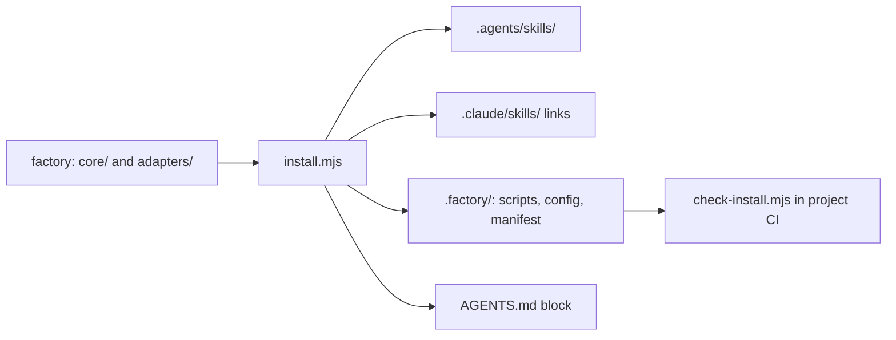

# Slice 02: skeleton

Status: proposed, waiting for the engineer's approval.

## Goal

- A project installs the factory and updates it with one command.
- The project detects edits to factory files, also in CI without a factory checkout.
- Skills are checked against the Agent Skills specification.
- The factory repo has CI, and a ruleset template protects the default branch.

## Out of scope

- hooks, lock, receipts, workflow gate, private-paths check: slice 03
- the skills themselves: slice 05
- adapters other than Claude Code
- `install.mjs --watch` and `--no-symlink`

## Sketch

## Acceptance scenarios

Each scenario becomes one black-box test under `test/acceptance/`, titled with its id. A test runs the script as its own process in temporary folders, and it checks only files, exit code and output.

### Install

- **AC-02-1 Fresh install.**
  - Given an empty project folder, when `install.mjs` runs, then the project contains:
    - each factory skill under `.agents/skills/<name>/`
    - a link `.claude/skills/<name>` → `../../.agents/skills/<name>`
    - the factory scripts under `.factory/scripts/`
    - `.factory/config.json` with empty `lockedPaths` and `privatePaths`
    - `AGENTS.md` with the factory block
    - `CLAUDE.md` with the line `@AGENTS.md`
    - `.factory/manifest.json`
  - The exit code is 0.
- **AC-02-2 Second run.** Given an installed project, when `install.mjs` runs again with the same factory, then no file changes, and the output reports 0 changes.
- **AC-02-3 Dry run.** Given an empty project, when `install.mjs --dry-run` runs, then the project stays empty, and the output lists every planned change.
- **AC-02-4 Check passes.** Given an installed project, when `install.mjs --check` runs, then the exit code is 0.
- **AC-02-5 Check finds an edited file.** Given an installed project with an edited skill file, when `install.mjs --check` runs, and when `.factory/scripts/check-install.mjs` runs in the project without the factory, then both exit with 1 and name the edited file.
- **AC-02-6 Check finds a missing link and an edited block.** Given an installed project without one skill link and with an edited factory block, when `install.mjs --check` runs, then it exits with 1 and names both.
- **AC-02-7 No overwrite of local edits.** Given an installed project with an edited skill file, and a factory with a newer version of that file, when `install.mjs` runs, then it exits with 1, names the file, and no file in the project changes.
- **AC-02-8 No overwrite of foreign files.** Given a project that already has its own file at a path where the factory writes, when `install.mjs` runs, then it exits with 1, names the file, and the file keeps its content.
- **AC-02-9 Existing AGENTS.md.** Given a project with its own `AGENTS.md`, when `install.mjs` runs twice, then the project's own text stays at the top, and the factory block appears exactly once.
- **AC-02-10 Existing CLAUDE.md.** Given a project with its own `CLAUDE.md` without `@AGENTS.md`, when `install.mjs` runs, then `CLAUDE.md` stays unchanged, and the output contains a warning that names the missing line.
- **AC-02-11 Skill removed from the factory.** Given an installed project, and a factory that no longer has one of the installed skills, when `install.mjs` runs, then that skill's folder and link are gone, the other skills stay, and `--check` passes.
- **AC-02-12 No adapter.** Given an empty project, when `install.mjs --adapter none` runs, then there is no `.claude/` folder and no `CLAUDE.md`, and the skills are installed.
- **AC-02-13 Unknown adapter.** Given an empty project, when `install.mjs --adapter nope` runs, then it exits with 2, and the output names the available adapters.

### Skill check

- **AC-02-14 Valid skill.** Given a skills folder with one skill that uses only standard fields, when `validate-skills.mjs` runs, then the exit code is 0.
- **AC-02-15 Invalid skills.** Given one skill per case below, when `validate-skills.mjs` runs, then it exits with 1 and prints one line per error with the file path and the reason:
  - the name differs from the folder name
  - the name has an uppercase letter, a double hyphen, or a hyphen at the start or end
  - no description
  - a description longer than 1024 characters
  - a field outside the standard
  - no frontmatter

### CI and ruleset (confirmed by the engineer, not automated)

- **AC-02-16 CI runs.** Given a pull request in the factory repo, then GitHub shows the check `factory-checks`, and it runs the acceptance tests and the skill check.
- **AC-02-17 The ruleset blocks.** Given the public repo with the imported ruleset, when a pull request has a failing `factory-checks`, then the merge button stays disabled, also for the repo owner.

## Architecture check

This check is not a scenario. It confirms ADR 0001: no file under `core/` names a specific agent tool.

## Evidence for this slice

- **Approved scenarios:** AC-02-1 to AC-02-15, as tests that the engineer reviewed.
- **Engineer confirmation:** AC-02-16 and AC-02-17.
- **ADR confirmation:** the architecture check.
- **Not evidence:** any unit tests the agent writes while building.

The lock arrives in slice 03. Until then, the agent does not change an approved scenario or its test. If one looks wrong, the agent stops and asks.

## Open questions

1. **Exit codes:** 2 for wrong usage (unknown option or adapter), 1 for a failed check or a refused install. Is that right?
2. **Skill check:** it belongs in this slice because CI needs it, even though the skills come in slice 05. Is that right?
3. **Scripts in the project:** the install copies every script from `core/scripts/` into `.factory/scripts/`, the skill check included. Is that right?
