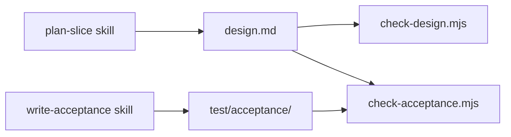

# Slice 02a: skills for the slice workflow

Status: proposed, waiting for the engineer's approval.

## Goal

- Two skills carry the slice workflow, so that `AGENTS.md` keeps only the rules and points to them:
  - `plan-slice` writes a design note.
  - `write-acceptance` writes the black-box tests for approved scenarios.
- Scripts check the results of both skills. The skills hold the judgment, and the scripts hold the structure that a machine can check (rule 2).
- The factory repo uses both skills for its own slices, starting with slice 02.

## Out of scope

- the lock, which makes approved scenarios and tests read-only: slice 03
- `install.mjs`, CI, ruleset: slice 02
- LLM evals of how well the skills work. They come only after an observed failure (rule 3).
- Gherkin `.feature` files. The factory's own scenarios are Markdown. Support for project formats such as Gherkin comes when `health` needs it.

## Sketch

## Acceptance scenarios

Each automated scenario becomes one black-box test under `test/acceptance/`, titled with its id. A test runs the script as its own process in temporary folders, and it checks only files, exit code and output.

### Skill check

- **AC-02a-1 Valid skill.** Given a skills folder with one skill that uses only the standard fields, when `validate-skills.mjs` runs, then the exit code is 0.
- **AC-02a-2 Invalid skills.** Given one skill per case below, when `validate-skills.mjs` runs, then it exits with 1 and prints one line per error with the file path and the reason:
  - the name differs from the folder name
  - the name has an uppercase letter, a double hyphen, or a hyphen at the start or end
  - no description
  - a description longer than 1024 characters
  - a field outside the standard
  - no frontmatter

### Design note check

- **AC-02a-3 Complete note.** Given a design note with a status line and the sections Goal, Out of scope, Acceptance scenarios, Evidence and Open questions, and scenario ids of the form `AC-<slice>-<n>` that match the slice folder, when `check-design.mjs` runs on the slice folder, then the exit code is 0.
- **AC-02a-4 Faulty note.** Given one note per case below, when `check-design.mjs` runs, then it exits with 1 and prints one line per problem:
  - a required section is missing
  - an id has the wrong form, or another slice number
  - an id appears twice
  - the note has more than 200 lines
  - a Mermaid sketch has more than 7 nodes

### Acceptance test check

- **AC-02a-5 Every scenario has its test.** Given a design note and `test/acceptance/` with exactly one test per scenario id, each test title starting with its id, when `check-acceptance.mjs` runs on the slice, then the exit code is 0. Scenarios under a heading that contains "confirmed by the engineer" need no test.
- **AC-02a-6 Missing or extra tests.** Given one case below, when `check-acceptance.mjs` runs, then it exits with 1 and names the id:
  - a scenario has no test
  - a scenario has two tests
  - a test names an id that is not in the design note

### The skills

- **AC-02a-7 Skills are valid and tool-neutral.** Given `core/skills/plan-slice` and `core/skills/write-acceptance`, when `validate-skills.mjs` runs on `core/skills`, then the exit code is 0. The architecture check of ADR 0001 also passes for both.
- **AC-02a-8 The factory finds its own skills.** Given the factory repo, then `.claude/skills/<name>` and `.agents/skills/<name>` exist for both skills, and each is a link to `../../core/skills/<name>`.

### Use in real work (confirmed by the engineer, not automated)

- **AC-02a-9 plan-slice works.** The agent uses `plan-slice` to rewrite the slice 02 design note. `check-design.mjs` passes, and the engineer finds the note usable.
- **AC-02a-10 write-acceptance works.** In slice 02, the agent uses `write-acceptance` for the slice 02 tests. `check-acceptance.mjs` passes, and the engineer finds the tests readable.

## Evidence for this slice

- **Approved scenarios:** AC-02a-1 to AC-02a-8, as tests that the engineer reviewed.
- **Engineer confirmation:** AC-02a-9 and AC-02a-10.
- **ADR confirmation:** the architecture check of ADR 0001.
- **Not evidence:** any unit tests the agent writes while building.

## After this slice

- `AGENTS.md` keeps the workflow as four short rules and points to the two skills for the details.
- The slice 02 design note loses AC-02-14 and AC-02-15, because the skill check moves here.

## Open questions

1. **Status line:** only the engineer sets `Status: approved` in a design note, the same as `accepted` in an ADR. Is that right?
2. **Test runner:** the acceptance tests use `node:test`, which is built into Node, so the factory needs no dependency. Test files are `test/acceptance/<slice>.test.mjs`. Is that right?
3. **Scenario format:** the factory writes its scenarios in Markdown, not Gherkin, because a Gherkin runner would be a dependency. Is that right?
